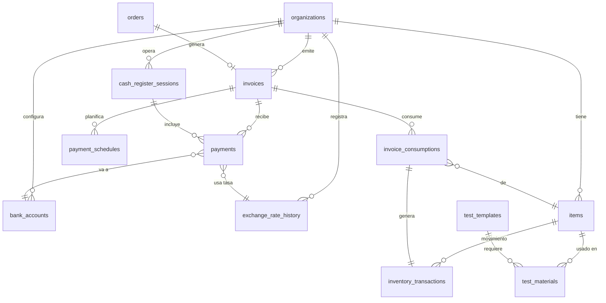
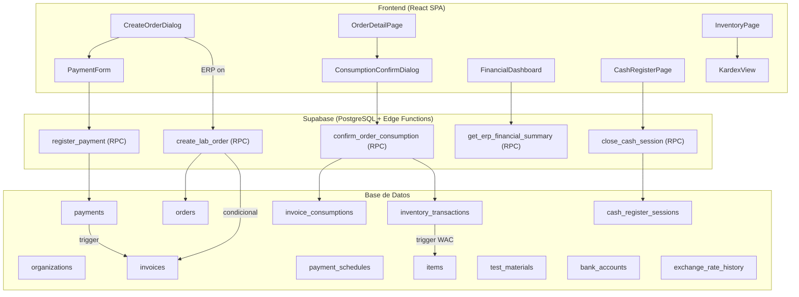

# 🏗️ Plan de Implementación: Módulo Administrativo (Mini-ERP) para MedLabCore

> **Versión:** 1.0 — Octubre 2026
> **Autor:** Plan generado tras análisis profundo del repositorio MedLabCore
> **Alcance:** Control Financiero, Gestión Multimoneda, Cuentas por Cobrar, Inventario (Kardex) y Costeo de Exámenes

---

## Estado de implementación

> Actualizado: 18 de octubre de 2026. Una tarea marcada con `[x]` está implementada en el repositorio; `[~]` significa código terminado pero pendiente de desplegar en Supabase (producción). Los criterios de aceptación de cada fase se marcan cuando se validan con las migraciones aplicadas.

- [x] Fase 1 — Infraestructura y feature flagging.
- [x] Fase 2 — Código terminado; migraciones aplicadas en producción (18 oct).
- [x] Fase 3 — Código terminado; migraciones aplicadas en producción (18 oct).
- [x] Fase 4 — Código terminado (diálogos, PDF, revisión, historial); migraciones aplicadas en producción (18 oct).
- [x] Fase 5 — Código terminado (catálogo, Kardex, WAC, compras, ajustes, alertas); migraciones aplicadas en producción (18 oct).
- [x] Fase 6 — Código terminado (recetas por examen, modal de consumo al aprobar, descuento automático); migraciones aplicadas en producción (18 oct).
- [x] Fase 7 — Código terminado (dashboard financiero, rentabilidad, inventario, antigüedad de saldos, PDFs, KPIs en el panel); migraciones aplicadas en producción (18 oct).
- [~] Fase 8 — Pruebas, auditoría RLS, rendimiento, vencidas automáticas, facturas retroactivas, paginación y guía de usuario terminados; base de datos desplegada en producción. Falta reemplazar `erpDb`, desplegar el frontend y el piloto (8.8–8.9).

### Despliegue a producción (18 oct 2026)

Proyecto `mgeateznuhmhgqemaphj` (plan Free: el panel no ofrece respaldos descargables).

1. **Respaldo** con `supabase db dump --linked` (roles, esquema y datos), guardado fuera del repositorio. Conteos verificados contra producción: 34 usuarios, 10 laboratorios, 1 072 pacientes, 1 526 órdenes, 5 818 ítems, 626 plantillas.
2. **Reparación del historial**: producción tenía la serie antigua `20260531…` (6 versiones), distinta de la línea base local. Se marcaron esas 6 como `reverted` y `20260920000000` / `20260920000001` como `applied` (`supabase migration repair`), sin ejecutarlas. `20260920000001` es un volcado completo de datos (incluye `auth.users`) y **nunca** debe ejecutarse en producción.
3. **`supabase db push`** aplicó `20260926220500` … `20261018000006` (15 migraciones). Las de sept./oct. ya estaban reflejadas en el esquema y son idempotentes.
4. **Verificado después**: historial con las 17 versiones; conteos sin cambios; `has_erp_module = false` en los 10 laboratorios; 0 facturas creadas; `pg_cron` instalado con el job `erp-mark-overdue-invoices` activo; todas las tablas `public` con RLS; `erp_rls_audit.sql` **pasa** en producción.
5. **Correcciones de seguridad incluidas** (`20261018000005`): un usuario ya no puede cambiar su propio `profiles.org_id` (trigger `trg_prevent_org_self_update`), y `anon` ya no puede ejecutar `create_lab_order`. `20261018000006` fija `exchange_rate_history.created_by` en el servidor.
6. Prueba en la app publicada (`main`): inicio de sesión como secretaria y creación de órdenes, **sin problemas**.
7. `npm run update-types` regenerado contra producción (ya incluye las tablas ERP).

**Importante:** las carpetas de migraciones de `main` y `dev` todavía tienen la serie `20260531…`. No ejecutar `supabase db push` desde esas ramas hasta fusionar esta línea base, porque intentaría reaplicarlas.

### Pendiente (acción del equipo)

1. Reemplazar `erpDb` (`src/features/erp/utils/erpDb.ts`) por el cliente tipado, ahora que `types.ts` incluye las tablas ERP.
2. Terminar la prueba manual en producción: firmas y pie de página, super admin (impersonar, crear organización y usuarios, cambiar roles), `/portal-paciente` e `/informe-pdf`.
3. Fusionar los 7 commits de `origin/dev` (reportes DOCX/Palermo) y desplegar el frontend.
4. Probar el flujo en un laboratorio piloto con `has_erp_module = true`. Las vistas previas de Vercel usan el mismo proyecto Supabase que producción.

### Validación realizada (18 oct 2026)

- `supabase/tests/erp_rpcs_smoke.sql`: prueba de integración de las RPCs contra el Postgres local, dentro de una transacción con `ROLLBACK` (no deja datos). Cubre: creación de orden con factura, apertura/cierre/revisión de caja, pago mixto USD/VES/Zelle, conciliación (sólo efectivo + fondo), anulación de pagos, cuotas con abonos previos, aislamiento entre laboratorios, ERP desactivado, WAC (ejemplo 9.2: $0.5333), ajustes, stock insuficiente, stock de sólo lectura, Kardex inmutable, recetas (RLS y aislamiento), vista previa del BOM, confirmación de consumo (stock, factura, Kardex, firma), idempotencia y rollback por falta de stock, y los cuatro reportes (permisos, rango inválido, cobrado vs. facturado, vencido, margen, inventario y antigüedad). **Pasa.**
- Tests unitarios: `cashRegister`, `inventory`, `consumption` y `reports` (`src/features/erp/utils/*.test.ts`, 24 tests). **Pasan.**
- `supabase/tests/erp_rls_audit.sql` (auditoría estática de RLS y privilegios) y `erp_reports_explain.sql` (rendimiento con volumen). **Pasan.**
- `tsc`, `eslint` (archivos ERP) y `npm run build`: sin errores en código ERP.
- Recorrido completo en el navegador contra el Supabase local con los tres roles (ver 8.3). **Pasa**, tras corregir los bugs encontrados.

### Fase 1 — tareas terminadas

- [x] 1.1–1.4: migración del flag, tipos, contexto y hook de permisos ERP.
- [x] 1.5–1.6: estado del módulo en Configuración y activación/desactivación por super admin.
- [x] 1.7–1.8: permisos específicos y navegación condicional (escritorio y móvil).

### Fase 2 — tareas terminadas en el repositorio

- [x] 2.1–2.4: migración única aditiva para tasas históricas, cuentas de cobro, facturas, índices, triggers y RLS.
- [x] 2.5: `create_lab_order` crea factura sólo para organizaciones con ERP habilitado.
- [x] 2.6: tipos de dominio ERP aislados mientras se regeneran los tipos de Supabase después del despliegue.
- [x] 2.7–2.9: hooks de tasas, cuentas y facturas.
- [x] 2.10–2.13: UI de cuentas de cobro, listado/detalle de facturas e historial de tasas.
- [x] 2.14–2.15: rutas protegidas y claves de React Query.
- [x] Corrección crítica: `create_lab_order` fallaba en **toda** organización con ERP activo (el estado de la factura se insertaba como texto, no como `invoice_status`). Corregido en `20261018000000_erp_hardening_and_cash_review.sql`.

### Mejoras incorporadas al diseño original

- La secuencia de factura usa `invoice_sequences` y un `UPSERT` atómico, en vez de `MAX(...) + 1`, para evitar números duplicados bajo concurrencia.
- La función de crear órdenes valida que el usuario creador pertenece a la organización; esto evita que una RPC `SECURITY DEFINER` pueda crear datos en otro laboratorio.
- Las políticas RLS incluyen `WITH CHECK` en las escrituras y se mantiene una relación uno-a-uno entre orden y factura.

### Fase 3 — avance actual

- [x] 3.1–3.5: libro inmutable de pagos, cuotas, RLS, RPCs atómicas y sincronización de saldo/estado de factura y orden.
- [x] 3.6–3.11: hooks, formulario de pago mixto, configurador de cuotas y vista de cuentas por cobrar.
- [x] 3.12: diálogo de cobro disponible al crear la orden, además del detalle de factura.
- [x] 3.13: RPC `void_payment` y botón "Anular pago" en el detalle de factura (motivo obligatorio; bloqueado si la caja del pago ya cerró).
- [x] 3.14: cada pago guarda `method_type` (trigger) para separar efectivo de medios electrónicos.
- [x] Corrección: `create_payment_schedule` validaba el rol `lab_admin` de *cualquier* laboratorio; ahora exige pertenecer a la organización de la factura. Al recrear un plan con abonos previos, éstos quedan como una cuota ya pagada para no aplicarse dos veces.
- [x] Corrección: el trigger de saldo fallaba al pagar una factura con cuotas (estado sin convertir al enum `schedule_status`).

### Fase 4 — avance actual

- [x] 4.1–4.5: sesiones de caja, RPCs de apertura/cierre, asociación automática de pagos, hook, ruta y pantalla operativa.
- [x] 4.6: `OpenCashDialog` (fondo inicial USD/VES y notas).
- [x] 4.7: `CloseCashDialog` con conciliación en vivo por moneda (esperado vs. contado, sobrante/faltante; notas obligatorias si hay diferencia).
- [x] 4.8: PDF `cashRegisterReportPDF.tsx` (cierre y corte parcial), con firmas de operador y supervisor.
- [x] 4.9: RPC `get_cash_session_summary` (totales en vivo, refresco cada minuto).
- [x] 4.10: conciliación corregida: efectivo esperado = fondo + cobros en efectivo; electrónicos aparte.
- [x] 4.11: RPC `review_cash_session` + historial de cierres con PDF y botón "Revisar" (sólo admin).
- [x] 4.12: endurecimiento de permisos y verificación de `has_erp_module` en todas las RPCs ERP.

### Fase 5 — avance actual

- [x] 5.1–5.3: migración única `20261018000001_erp_inventory_kardex.sql` (`items`, `inventory_transactions`, trigger WAC, RLS por laboratorio y rol).
- [x] 5.4–5.5: RPCs `register_purchase` (incluye inventario inicial) y `register_adjustment` (motivo obligatorio).
- [x] 5.6–5.7: hooks en `src/features/erp/hooks/useInventory.ts` (catálogo, Kardex, compras y ajustes; se consolidaron en un archivo).
- [x] 5.8: página `/erp/inventory` con búsqueda, filtro por categoría, valor total y conteo de bajo stock.
- [x] 5.9: `ItemForm` (con carga opcional de stock inicial como movimiento `initial`).
- [x] 5.10: `KardexView` con stock y costo promedio después de cada movimiento.
- [x] 5.11: `PurchaseEntryDialog` con vista previa del nuevo costo promedio.
- [x] 5.12: `AdjustmentDialog` (entrada/salida, bloquea stock negativo).
- [x] 5.13: `LowStockAlerts`.
- [x] 5.14: `current_stock`, `unit_cost` y `total_value` sólo cambian por el Kardex (trigger de protección); `inventory_transactions` rechaza `UPDATE`.
- [x] 5.15: ruta, permisos (`lab_admin`, `bioanalyst`) y navegación (menú lateral; en móvil sólo para bioanalistas).
- [x] 5.16: tests unitarios de WAC, bajo stock, valor y búsqueda.

### Fase 6 — avance actual

- [x] 6.1–6.2: migración `20261018000002_erp_bom_consumption.sql` (`test_materials`, `invoice_consumptions`, FK del Kardex a consumos, columnas `consumption_confirmed_at/by` en `orders`). Las recetas son por laboratorio aunque el examen sea una plantilla global; un trigger impide usar insumos de otro laboratorio.
- [x] 6.3: RPC `confirm_order_consumption`: idempotente, valida pertenencia y ERP, registra consumos, descuenta stock vía Kardex y **completa la orden con la firma** en una sola transacción. Si falta stock no descuenta nada y la orden sigue abierta.
- [x] 6.4: RPC `get_order_bom_preview` (omite encabezados de perfil e insumos inactivos o no rastreables).
- [x] 6.5: hook `useTestMaterials` (leer, agregar/actualizar por upsert, quitar).
- [x] 6.6: hook `useOrderConsumption` (vista previa y confirmación).
- [x] 6.7: `TestMaterialsEditor`: botón "Insumos" por examen en la página de Exámenes (edita `lab_admin`, consulta bioanalista) con costo estimado por examen.
- [x] 6.8: `ConsumptionConfirmDialog`: consumo agrupado por examen, ajuste de cantidades (motivo obligatorio), "Repetir examen", insumos extra, totales por insumo, costo de producción y bloqueo si falta stock.
- [x] 6.9: "Aprobar y Firmar" en `OrderDetailPage` abre el modal cuando el ERP está activo; sin ERP el flujo es idéntico al anterior.
- [x] Tests unitarios `consumption.test.ts` y casos de BOM/consumo en `erp_rpcs_smoke.sql` (pasan).

### Fase 7 — avance actual

- [x] 7.1–7.4: migración `20261018000003_erp_reports.sql` con `get_erp_financial_summary`, `get_erp_profitability_report`, `get_erp_inventory_summary` y `get_accounts_receivable_report` (ver correcciones en 11.4).
- [x] 7.5: hook `useErpReports` (cuatro consultas, filtradas por período).
- [x] 7.6: página `/erp/reports` (`FinancialDashboardPage`) con pestañas Finanzas, Rentabilidad, Cuentas por cobrar e Inventario, y filtro de período (hoy, este mes, mes anterior, 30 días, personalizado).
- [x] 7.6 (gráficos): cobrado por día (Recharts, con tabla de datos), cobrado por método y por moneda, comparación contra el período anterior.
- [x] 7.7: `ProfitabilityReport`: ingresos − costo de insumos, margen, tabla por examen/perfil y alerta de margen < 50%.
- [x] 7.8: `InventoryDashboard`: valor, compras, consumo, pérdidas, bajo stock, por vencer (30 días), más consumidos y valor por categoría.
- [x] 7.9: `AccountsReceivableReport`: antigüedad (por vencer, 1–30, 31–60, 61–90, +90) y facturas pendientes.
- [x] 7.10: PDF `financialReportPDF.tsx` (KPIs, métodos, monedas, antigüedad, rentabilidad por examen).
- [x] 7.11: PDF `inventoryReportPDF.tsx` (KPIs, por vencer, más consumidos y hoja de existencias/valoración).
- [x] 7.12: `ErpDashboardWidgets` en el Panel de control: cobrado hoy/mes, por cobrar, vencido y alerta de bajo stock.
- [x] Permisos: finanzas, rentabilidad y cuentas por cobrar sólo `lab_admin`; el bioanalista ve sólo Inventario. Menú lateral "Reportes".
- [x] Tests: `reports.test.ts` (períodos, variaciones, porcentajes) y casos de reportes en `erp_rpcs_smoke.sql` (montos esperados verificados).

### Fase 8 — avance actual

- [x] 8.1: tests unitarios de cálculos (WAC, conciliación de caja, consumo, períodos y porcentajes, mensajes de error): 24 tests en `src/features/erp/utils/*.test.ts`.
- [x] 8.2: integración de todas las RPCs ERP en `supabase/tests/erp_rpcs_smoke.sql`.
- [x] 8.3: flujo completo verificado **en la base** (smoke test) y **en el navegador** contra el Supabase local, con el laboratorio demo de `supabase/seed_erp_demo.sql` (3 usuarios: admin, secretaria, bioanalista):
  1. Admin: insumos con stock inicial, compra con lote y vencimiento (WAC 0,5333 y valor $80,00 como en 9.2), Kardex, receta de Hematología, apertura de caja.
  2. Orden de $23 (Hematología + Glicemia) → factura automática → pago mixto ($10 en efectivo + Bs 8 801,16 por pago móvil a la tasa del día) → saldo $3, estado parcial.
  3. Bioanalista: "Aprobar y Firmar" → modal de consumo → "Repetir examen" → confirmación: stock descontado, 4 consumos, orden completada y firmada.
  4. Secretaria: cierre de caja con faltante de Bs 20 (nota obligatoria) y PDF de cierre.
  5. Admin: revisión del cierre, las cuatro pestañas de Reportes, PDF financiero y de inventario, y KPIs en el Panel de control.
  - **Bugs encontrados y corregidos en el recorrido:**
    - **Crítico:** ninguna pantalla de facturas cargaba (listado, detalle, cobro al crear la orden, cuentas por cobrar). PostgREST respondía 300, porque `invoices` y `orders` se referencian mutuamente y el embed `orders(...)` era ambiguo. Se corrigió con `orders!invoices_order_id_fkey(...)`.
    - **Crítico:** los pagos en bolívares se convertían con el historial manual de tasas, mientras que las órdenes usan la tasa automática del BCV. Con un historial desactualizado (40 contra 880), un pago de Bs 880 contaba como $22. Ahora el formulario precarga la tasa del día, la misma de la orden, y sigue siendo editable.
    - Recargar o entrar directo a cualquier `/erp/*` redirigía al panel: `ErpGuard` decidía antes de cargar la organización. Ahora espera a que cargue.
    - PDF de cierre: columnas superpuestas (los anchos sumaban 102 %). PDF de inventario: columnas Mín./Costo pegadas.
    - Costos unitarios con 4 decimales (`formatUnitCost`): 0,5333 se mostraba como 0,53.
    - Rentabilidad: los exámenes sin receta se marcan "sin insumos registrados" en vez de mostrar un 100 % de margen engañoso. El PDF financiero ahora siempre incluye la antigüedad de saldos.
  - Observación revisada: la página de Exámenes del laboratorio demo lista 124 plantillas (122 globales compartidas por diseño + 2 propias). No es una fuga entre laboratorios.
- [x] 8.4: auditoría de RLS (`supabase/tests/erp_rls_audit.sql`, reutilizable antes de cada despliegue) y aislamiento en ejecución entre laboratorios dentro del smoke test. Hallazgos corregidos en `20261018000004_erp_security_and_operations.sql`:
  - **Crítico:** `invoice_sequences` no tenía RLS. Cualquier cliente con la llave pública, incluso sin sesión, podía modificar el contador de facturas de otro laboratorio y romper la creación de sus órdenes.
  - `get_exchange_rate` devolvía la tasa de cualquier laboratorio, incluso sin sesión.
  - Se quitaron todos los privilegios de `anon` sobre las tablas y RPCs ERP (defensa en profundidad).
- [x] 8.5: índices por fecha local para los reportes. Medido con 40 000 facturas y ~60 000 pagos por laboratorio (`supabase/tests/erp_reports_explain.sql`):
  - Resumen financiero: de 159 ms a 44 ms (el monto vencido ahora se calcula en forma de conjunto).
  - Rentabilidad: 3 ms. Inventario: 4 ms.
  - Antigüedad de saldos con 10 000 facturas abiertas: de 328 ms a 131 ms (paginada).
  - La consulta de pagos por rango usa el índice nuevo: 0,6 ms.
- [x] 8.6: RPC `erp_backfill_invoices` (vista previa + generación, idempotente) y botón **Generar facturas retroactivas** en Configuración (sólo administrador).
- [x] 8.7: guía de usuario en `docs/ERP_GUIA_USUARIO.md`.
- [ ] 8.8: despliegue gradual en laboratorios piloto (acción del equipo; ver 12.2).
- [~] 8.9: migraciones aplicadas en producción y tipos regenerados (18 oct); falta reemplazar `erpDb` por el cliente tipado.
- [x] 8.10: `mark_overdue_invoices()` programado diariamente con `pg_cron` (06:00 Caracas). Además, el trigger de saldo mantiene el estado *vencida* tras un abono parcial. "Cuentas por cobrar" ahora incluye las facturas vencidas, que antes no aparecían.
- [x] 8.11: paginación en Facturas (25 por página, con total), "Cargar más" en el Kardex y en el historial de cajas, y antigüedad de saldos limitada a las 200 más vencidas con "Mostrar más".

---

## 📋 Tabla de Contenidos

1. [Diagnóstico del Estado Actual](#1-diagnóstico-del-estado-actual)
2. [Tablas y Esquemas Afectados](#2-tablas-y-esquemas-afectados)
3. [Arquitectura y Feature Flagging](#3-arquitectura-y-feature-flagging)
4. [Esquema de Base de Datos Completo (Nuevas Tablas)](#4-esquema-de-base-de-datos-completo-nuevas-tablas)
5. [Fase 1 — Infraestructura y Feature Flagging](#5-fase-1--infraestructura-y-feature-flagging)
6. [Fase 2 — Módulo Financiero y Facturación](#6-fase-2--módulo-financiero-y-facturación)
7. [Fase 3 — Pagos Fraccionados y Cuentas por Cobrar](#7-fase-3--pagos-fraccionados-y-cuentas-por-cobrar)
8. [Fase 4 — Cierre de Caja y Conciliación](#8-fase-4--cierre-de-caja-y-conciliación)
9. [Fase 5 — Inventario y Kardex](#9-fase-5--inventario-y-kardex)
10. [Fase 6 — BOM (Recetas) y Consumo Automático](#10-fase-6--bom-recetas-y-consumo-automático)
11. [Fase 7 — Reportes y Dashboards](#11-fase-7--reportes-y-dashboards)
12. [Fase 8 — Refinamiento, Testing y Producción](#12-fase-8--refinamiento-testing-y-producción)
13. [Diagrama de Arquitectura General](#13-diagrama-de-arquitectura-general)
14. [Consideraciones Adicionales Recomendadas](#14-consideraciones-adicionales-recomendadas)
15. [Resumen de Archivos a Crear/Modificar](#15-resumen-de-archivos-a-crearmodificar)

---

## 1. Diagnóstico del Estado Actual

### 1.1 Arquitectura Existente

| Aspecto | Estado Actual |
|---|---|
| **Framework** | React 18 + Vite 8 + TypeScript 5.8 (SPA) |
| **Backend** | Supabase (PostgreSQL 17) con RLS + Edge Functions (Deno) |
| **State Management** | TanStack React Query + Zustand + Context |
| **UI** | Radix UI + shadcn/ui + Tailwind CSS |
| **Multi-tenancy** | Basado en `org_id` con RLS policies en todas las tablas |
| **Roles** | `super_admin`, `lab_admin`, `bioanalyst`, `secretary`, `lab_affiliate` |
| **Feature Flags** | **No existe un sistema formal** — sólo control por roles y columnas como `is_active`, `subscription_active` |

### 1.2 Modelo Financiero Actual (Limitaciones)

El sistema actual tiene las finanzas **embebidas directamente en la tabla `orders`**:

```
orders
├── total_amount      (USD) — precio total de la orden
├── total_bs          (Bs)  — equivalente en bolívares
├── exchange_rate     (numeric) — tasa capturada al crear la orden
├── payment_status    (ENUM: unpaid | partial | paid | pending)
└── is_exempted       (boolean) — orden cortesía/exonerada
```

**Problemas del modelo actual:**
- ❌ No hay registro de **pagos individuales** (no se sabe cuándo ni cómo pagó el paciente)
- ❌ No se registra el **método de pago** (efectivo, transferencia, Zelle, pago móvil)
- ❌ No hay soporte para **pagos fraccionados reales** (se marca "partial" manualmente, sin registro)
- ❌ No existe tabla de **cuentas bancarias** ni métodos de recepción
- ❌ No hay **facturación formal** separada de la orden médica
- ❌ No hay **cuentas por cobrar** ni planes de crédito
- ❌ No existe **cierre de caja** ni conciliación
- ❌ No existe **inventario, Kardex, ni control de insumos**
- ❌ No hay **costeo de exámenes** ni análisis de rentabilidad

### 1.3 Tabla `exchange_rates` Actual

La tabla `exchange_rates` actual almacena **una sola tasa por organización** (no es histórica):

```sql
exchange_rates
├── id        (uuid PK)
├── org_id    (uuid UNIQUE FK) -- ⚠️ Solo UNA tasa por lab
├── rate      (numeric)        -- tasa actual USD→Bs
├── updated_at (timestamptz)
└── updated_by (uuid FK)
```

Esto **no** sirve para auditoría histórica. Necesitamos un registro histórico de tasas.

---

## 2. Tablas y Esquemas Afectados

### 2.1 Tablas Existentes que se MODIFICARÁN

| Tabla | Cambio | Impacto |
|---|---|---|
| `organizations` | Agregar columna `has_erp_module` (boolean, default `false`) | Bajo — solo agregar columna |
| `orders` | Agregar columna `invoice_id` (uuid FK nullable) para vincular con factura ERP | Bajo — columna opcional |
| `exchange_rates` | Eliminar constraint UNIQUE en `org_id`, agregar `effective_date` para historial | Medio — migración de datos |

### 2.2 Tablas Existentes que NO se tocan

| Tabla | Razón |
|---|---|
| `profiles` | Sin cambios necesarios |
| `user_roles` | Sin cambios |
| `patients` | Sin cambios |
| `order_items` | Sin cambios directos (se vincula vía BOM al confirmar consumo) |
| `test_templates` | Sin cambios directos (se referencia desde `test_materials` BOM) |
| `exam_profiles` | Sin cambios |
| `profile_templates_junction` | Sin cambios |
| `test_methods` | Sin cambios |
| `antibiotics` | Sin cambios |
| `organization_exam_settings` | Sin cambios |
| `organization_test_category_settings` | Sin cambios |
| `audit_logs` | Sin cambios en estructura (se agregarán nuevos tipos de eventos) |

### 2.3 Funciones RPC Existentes Afectadas

| Función | Cambio |
|---|---|
| `create_lab_order` | Condicional: si `has_erp_module = true` → crear factura automáticamente |
| `get_dashboard_summary` | Extender para incluir métricas financieras si ERP activo |
| `trg_fn_audit_orders` | Agregar nuevos eventos de auditoría ERP |

---

## 3. Arquitectura y Feature Flagging

### 3.1 Estrategia de Condicionamiento

```
┌──────────────────────────────────────────────────┐
│              organizations.has_erp_module         │
│                                                  │
│  false (default):                                │
│  ├── Flujo actual intacto                        │
│  ├── orders.payment_status se gestiona manual    │
│  ├── No se muestran módulos ERP en sidebar       │
│  └── Completar orden = solo cambiar status       │
│                                                  │
│  true (premium activado):                        │
│  ├── Se crea Invoice automática al crear orden   │
│  ├── Se habilita registro de pagos detallados    │
│  ├── Se activan módulos de Inventario/Kardex     │
│  ├── Modal de confirmación de consumo al completar│
│  └── Reportes financieros y dashboards avanzados │
└──────────────────────────────────────────────────┘
```

### 3.2 Implementación del Feature Flag

**Backend (PostgreSQL):**
```sql
ALTER TABLE public.organizations
  ADD COLUMN has_erp_module BOOLEAN NOT NULL DEFAULT false;
```

**Frontend (React Hook):**
```typescript
// src/hooks/useErpModule.ts
export function useErpModule() {
  const { organization } = useCurrentOrgContext();
  return {
    isErpEnabled: organization?.has_erp_module ?? false,
  };
}
```

**Principio fundamental:** Todo nuevo código ERP debe estar envuelto en:
```typescript
if (isErpEnabled) {
  // lógica ERP
} else {
  // flujo actual sin cambios
}
```

---

## 4. Esquema de Base de Datos Completo (Nuevas Tablas)

### 4.0 Diagrama Entidad-Relación



### 4.1 `exchange_rate_history` — Historial de Tasas de Cambio

> Registra el valor diario/horario de las monedas para cálculos históricos precisos.

```sql
CREATE TABLE public.exchange_rate_history (
  id            UUID PRIMARY KEY DEFAULT gen_random_uuid(),
  org_id        UUID NOT NULL REFERENCES public.organizations(id) ON DELETE CASCADE,

  -- Monedas
  from_currency TEXT NOT NULL DEFAULT 'USD',  -- ISO 4217
  to_currency   TEXT NOT NULL DEFAULT 'VES',  -- ISO 4217

  -- Tasa
  rate          NUMERIC(18,8) NOT NULL,       -- ej: 1 USD = 55.75 VES
  source        TEXT NOT NULL DEFAULT 'manual', -- 'manual' | 'api:bcv' | 'api:dolarapi'

  -- Vigencia
  effective_date DATE NOT NULL DEFAULT CURRENT_DATE,

  -- Auditoría
  created_at    TIMESTAMPTZ NOT NULL DEFAULT now(),
  created_by    UUID REFERENCES auth.users(id),

  -- Constraints
  CONSTRAINT exchange_rate_history_unique_per_day
    UNIQUE (org_id, from_currency, to_currency, effective_date)
);

CREATE INDEX idx_erh_org_date ON public.exchange_rate_history(org_id, effective_date DESC);
CREATE INDEX idx_erh_lookup ON public.exchange_rate_history(org_id, from_currency, to_currency, effective_date DESC);

-- Función helper para obtener la tasa vigente
CREATE OR REPLACE FUNCTION public.get_exchange_rate(
  p_org_id UUID,
  p_from TEXT DEFAULT 'USD',
  p_to TEXT DEFAULT 'VES',
  p_date DATE DEFAULT CURRENT_DATE
) RETURNS NUMERIC AS $$
  SELECT rate
  FROM public.exchange_rate_history
  WHERE org_id = p_org_id
    AND from_currency = p_from
    AND to_currency = p_to
    AND effective_date <= p_date
  ORDER BY effective_date DESC
  LIMIT 1;
$$ LANGUAGE sql STABLE SECURITY DEFINER SET search_path TO 'public';

COMMENT ON TABLE public.exchange_rate_history IS
  'Historial inmutable de tasas de cambio por organización. Cada registro representa la tasa vigente para un día específico.';
```

### 4.2 `bank_accounts` — Cuentas / Métodos de Recepción de Dinero

> Donde el Admin configura sus métodos de recepción (Caja, Zelle, Pago Móvil, Punto de Venta, etc.)

```sql
CREATE TYPE public.payment_method_type AS ENUM (
  'cash',           -- Efectivo
  'bank_transfer',  -- Transferencia bancaria
  'mobile_payment', -- Pago móvil (Banesco, Mercantil, etc.)
  'zelle',          -- Zelle
  'pos_terminal',   -- Punto de Venta (POS)
  'other'           -- Otros
);

CREATE TABLE public.bank_accounts (
  id              UUID PRIMARY KEY DEFAULT gen_random_uuid(),
  org_id          UUID NOT NULL REFERENCES public.organizations(id) ON DELETE CASCADE,

  -- Información de la cuenta
  name            TEXT NOT NULL,                    -- ej: "Caja Efectivo USD", "Banesco PM"
  method_type     public.payment_method_type NOT NULL DEFAULT 'cash',
  currency        TEXT NOT NULL DEFAULT 'USD',      -- ISO 4217: USD, VES
  description     TEXT,                             -- notas adicionales

  -- Datos bancarios opcionales
  bank_name       TEXT,                             -- nombre del banco
  account_number  TEXT,                             -- número de cuenta (parcial por seguridad)
  account_holder  TEXT,                             -- titular
  phone_number    TEXT,                             -- para pago móvil
  email           TEXT,                             -- para Zelle

  -- Estado
  is_active       BOOLEAN NOT NULL DEFAULT true,
  sort_order      INTEGER NOT NULL DEFAULT 0,

  -- Auditoría
  created_at      TIMESTAMPTZ NOT NULL DEFAULT now(),
  updated_at      TIMESTAMPTZ NOT NULL DEFAULT now(),

  -- Constraints
  CONSTRAINT bank_accounts_name_unique UNIQUE (org_id, name)
);

CREATE INDEX idx_bank_accounts_org ON public.bank_accounts(org_id, is_active, sort_order);

COMMENT ON TABLE public.bank_accounts IS
  'Métodos de recepción de dinero configurados por cada laboratorio: efectivo, transferencias, Zelle, pago móvil, POS, etc.';
```

### 4.3 `invoices` — Facturas / Cuentas por Cobrar

> Separa el registro financiero de la orden médica. Cada orden con ERP activo genera una factura.

```sql
CREATE TYPE public.invoice_status AS ENUM (
  'draft',       -- Borrador (recién creada)
  'issued',      -- Emitida / activa
  'partial',     -- Parcialmente pagada
  'paid',        -- Totalmente pagada
  'overdue',     -- Vencida
  'cancelled',   -- Anulada
  'credit_note'  -- Nota de crédito
);

CREATE TABLE public.invoices (
  id                UUID PRIMARY KEY DEFAULT gen_random_uuid(),
  org_id            UUID NOT NULL REFERENCES public.organizations(id) ON DELETE CASCADE,

  -- Numeración fiscal
  invoice_number    TEXT NOT NULL,                   -- Secuencial: FAC-2026-0001
  invoice_seq       INTEGER NOT NULL,                -- Secuencial numérico por org

  -- Relaciones
  order_id          UUID NOT NULL REFERENCES public.orders(id) ON DELETE RESTRICT,
  patient_id        UUID NOT NULL REFERENCES public.patients(id) ON DELETE RESTRICT,

  -- Montos (Moneda base: USD)
  subtotal_usd      NUMERIC(12,2) NOT NULL DEFAULT 0,  -- Subtotal sin descuento
  discount_pct      NUMERIC(5,2) NOT NULL DEFAULT 0,    -- % descuento (0-100)
  discount_amount   NUMERIC(12,2) NOT NULL DEFAULT 0,   -- Monto descuento en USD
  tax_pct           NUMERIC(5,2) NOT NULL DEFAULT 0,    -- % impuesto (IVA si aplica)
  tax_amount        NUMERIC(12,2) NOT NULL DEFAULT 0,   -- Monto impuesto en USD
  total_usd         NUMERIC(12,2) NOT NULL DEFAULT 0,   -- Total final en USD

  -- Equivalencia en moneda local
  exchange_rate_id  UUID REFERENCES public.exchange_rate_history(id), -- Tasa usada
  exchange_rate     NUMERIC(18,8),                   -- Snapshot de la tasa
  total_local       NUMERIC(14,2),                   -- Total en VES

  -- Saldos calculados
  amount_paid_usd   NUMERIC(12,2) NOT NULL DEFAULT 0,   -- Total pagado acumulado
  balance_due_usd   NUMERIC(12,2) NOT NULL DEFAULT 0,   -- Saldo pendiente

  -- Estado y vencimiento
  status            public.invoice_status NOT NULL DEFAULT 'issued',
  issued_at         TIMESTAMPTZ NOT NULL DEFAULT now(),
  due_date          DATE,                            -- Fecha límite de pago
  paid_at           TIMESTAMPTZ,                     -- Cuando se pagó completa
  cancelled_at      TIMESTAMPTZ,                     -- Cuando se anuló

  -- Notas
  notes             TEXT,
  is_exempted       BOOLEAN NOT NULL DEFAULT false,  -- Cortesía/exoneración

  -- Auditoría
  created_at        TIMESTAMPTZ NOT NULL DEFAULT now(),
  updated_at        TIMESTAMPTZ NOT NULL DEFAULT now(),
  created_by        UUID NOT NULL REFERENCES auth.users(id),

  -- Constraints
  CONSTRAINT invoices_number_unique UNIQUE (org_id, invoice_number)
);

CREATE INDEX idx_invoices_org ON public.invoices(org_id, status, issued_at DESC);
CREATE INDEX idx_invoices_order ON public.invoices(order_id);
CREATE INDEX idx_invoices_patient ON public.invoices(patient_id);
CREATE INDEX idx_invoices_status ON public.invoices(org_id, status);
CREATE INDEX idx_invoices_due_date ON public.invoices(org_id, due_date)
  WHERE status IN ('issued', 'partial', 'overdue');

-- Trigger para secuencial de factura
CREATE OR REPLACE FUNCTION public.get_next_invoice_seq()
RETURNS TRIGGER AS $$
BEGIN
  SELECT COALESCE(MAX(invoice_seq), 0) + 1
  INTO NEW.invoice_seq
  FROM public.invoices
  WHERE org_id = NEW.org_id;

  NEW.invoice_number := 'FAC-' ||
    TO_CHAR(CURRENT_DATE, 'YYYY') || '-' ||
    LPAD(NEW.invoice_seq::TEXT, 6, '0');

  RETURN NEW;
END;
$$ LANGUAGE plpgsql;

CREATE TRIGGER trg_set_invoice_seq
  BEFORE INSERT ON public.invoices
  FOR EACH ROW
  EXECUTE FUNCTION public.get_next_invoice_seq();

COMMENT ON TABLE public.invoices IS
  'Facturas emitidas por el laboratorio. Separa el registro financiero de la orden médica. Soporta descuentos, impuestos, y seguimiento de saldo pendiente.';
```

### 4.4 `payments` — Pagos Fraccionados

> Registro de cada pago individual. Relación "Muchos a Uno" con la factura. Soporta pagos múltiples simultáneos en diferentes monedas y métodos.

```sql
CREATE TABLE public.payments (
  id                UUID PRIMARY KEY DEFAULT gen_random_uuid(),
  org_id            UUID NOT NULL REFERENCES public.organizations(id) ON DELETE CASCADE,

  -- Relación con factura
  invoice_id        UUID NOT NULL REFERENCES public.invoices(id) ON DELETE RESTRICT,

  -- Monto del pago
  amount            NUMERIC(12,2) NOT NULL,          -- Monto pagado (en la moneda indicada)
  currency          TEXT NOT NULL DEFAULT 'USD',      -- ISO 4217
  amount_usd        NUMERIC(12,2) NOT NULL,          -- Equivalente en USD (moneda base)

  -- Tasa de cambio aplicada
  exchange_rate_id  UUID REFERENCES public.exchange_rate_history(id),
  exchange_rate     NUMERIC(18,8),                    -- Snapshot: tasa usada para conversión

  -- Método de pago
  bank_account_id   UUID REFERENCES public.bank_accounts(id) ON DELETE SET NULL,
  payment_method    TEXT,                             -- Nombre del método (snapshot)

  -- Referencia y comprobante
  reference_number  TEXT,                             -- # de referencia, confirmación
  receipt_url       TEXT,                             -- URL de comprobante (Storage)

  -- Cierre de caja
  cash_session_id   UUID,                             -- FK a cash_register_sessions (se agrega después)

  -- Estado
  is_void           BOOLEAN NOT NULL DEFAULT false,   -- Anulado
  void_reason       TEXT,                             -- Razón de anulación

  -- Auditoría
  payment_date      TIMESTAMPTZ NOT NULL DEFAULT now(),
  created_at        TIMESTAMPTZ NOT NULL DEFAULT now(),
  created_by        UUID NOT NULL REFERENCES auth.users(id),

  -- Validación
  CONSTRAINT payments_amount_positive CHECK (amount > 0),
  CONSTRAINT payments_amount_usd_positive CHECK (amount_usd > 0)
);

CREATE INDEX idx_payments_invoice ON public.payments(invoice_id);
CREATE INDEX idx_payments_org ON public.payments(org_id, payment_date DESC);
CREATE INDEX idx_payments_bank_account ON public.payments(bank_account_id, payment_date DESC);
CREATE INDEX idx_payments_cash_session ON public.payments(cash_session_id);

-- Trigger para actualizar saldo de factura automáticamente
CREATE OR REPLACE FUNCTION public.trg_fn_update_invoice_balance()
RETURNS TRIGGER AS $$
DECLARE
  v_total_paid NUMERIC(12,2);
  v_total_usd  NUMERIC(12,2);
  v_new_status public.invoice_status;
BEGIN
  -- Calcular total pagado no anulado
  SELECT COALESCE(SUM(amount_usd), 0)
  INTO v_total_paid
  FROM public.payments
  WHERE invoice_id = COALESCE(NEW.invoice_id, OLD.invoice_id)
    AND is_void = false;

  -- Obtener total de la factura
  SELECT total_usd INTO v_total_usd
  FROM public.invoices
  WHERE id = COALESCE(NEW.invoice_id, OLD.invoice_id);

  -- Determinar nuevo estado
  IF v_total_paid >= v_total_usd THEN
    v_new_status := 'paid';
  ELSIF v_total_paid > 0 THEN
    v_new_status := 'partial';
  ELSE
    v_new_status := 'issued';
  END IF;

  -- Actualizar factura
  UPDATE public.invoices
  SET amount_paid_usd = v_total_paid,
      balance_due_usd = GREATEST(v_total_usd - v_total_paid, 0),
      status = v_new_status,
      paid_at = CASE WHEN v_new_status = 'paid' THEN now() ELSE NULL END,
      updated_at = now()
  WHERE id = COALESCE(NEW.invoice_id, OLD.invoice_id);

  -- Sincronizar payment_status en orders (compatibilidad con flujo actual)
  UPDATE public.orders
  SET payment_status = CASE
    WHEN v_new_status = 'paid' THEN 'paid'::public.payment_status
    WHEN v_new_status = 'partial' THEN 'partial'::public.payment_status
    ELSE 'unpaid'::public.payment_status
  END
  FROM public.invoices inv
  WHERE inv.id = COALESCE(NEW.invoice_id, OLD.invoice_id)
    AND orders.id = inv.order_id;

  RETURN NEW;
END;
$$ LANGUAGE plpgsql SECURITY DEFINER SET search_path TO 'public';

CREATE TRIGGER trg_update_invoice_balance
  AFTER INSERT OR UPDATE OR DELETE ON public.payments
  FOR EACH ROW
  EXECUTE FUNCTION public.trg_fn_update_invoice_balance();

COMMENT ON TABLE public.payments IS
  'Registro inmutable de pagos individuales. Cada pago se vincula a una factura, un método de pago, y una tasa de cambio. Soporta pagos múltiples simultáneos en diferentes monedas.';
```

### 4.5 `payment_schedules` — Cuotas y Cuentas por Cobrar

> Planificación de pagos futuros cuando no se paga el 100%. Cada cuota tiene fecha de vencimiento.

```sql
CREATE TYPE public.schedule_status AS ENUM (
  'pending',    -- Pendiente de pago
  'partial',    -- Parcialmente pagada
  'paid',       -- Pagada completamente
  'overdue',    -- Vencida
  'cancelled'   -- Cancelada/condonada
);

CREATE TABLE public.payment_schedules (
  id              UUID PRIMARY KEY DEFAULT gen_random_uuid(),
  org_id          UUID NOT NULL REFERENCES public.organizations(id) ON DELETE CASCADE,

  -- Relación
  invoice_id      UUID NOT NULL REFERENCES public.invoices(id) ON DELETE CASCADE,

  -- Cuota
  installment_number INTEGER NOT NULL,              -- 1, 2, 3...
  amount_due_usd  NUMERIC(12,2) NOT NULL,           -- Monto esperado
  amount_paid_usd NUMERIC(12,2) NOT NULL DEFAULT 0, -- Monto pagado contra esta cuota

  -- Fechas
  due_date        DATE NOT NULL,                     -- Fecha de vencimiento
  paid_at         TIMESTAMPTZ,                       -- Cuando se cubrió

  -- Estado
  status          public.schedule_status NOT NULL DEFAULT 'pending',

  -- Notas
  notes           TEXT,

  -- Auditoría
  created_at      TIMESTAMPTZ NOT NULL DEFAULT now(),
  updated_at      TIMESTAMPTZ NOT NULL DEFAULT now(),

  -- Constraints
  CONSTRAINT ps_unique_installment UNIQUE (invoice_id, installment_number),
  CONSTRAINT ps_amount_positive CHECK (amount_due_usd > 0)
);

CREATE INDEX idx_payment_schedules_invoice ON public.payment_schedules(invoice_id);
CREATE INDEX idx_payment_schedules_overdue ON public.payment_schedules(org_id, due_date, status)
  WHERE status IN ('pending', 'partial');

COMMENT ON TABLE public.payment_schedules IS
  'Plan de pagos en cuotas para facturas con crédito. Cada cuota tiene fecha de vencimiento y estado independiente para seguimiento de cuentas por cobrar.';
```

### 4.6 `cash_register_sessions` — Sesiones de Cierre de Caja

> Permite agrupar pagos recibidos por turno/día para conciliación.

```sql
CREATE TYPE public.cash_session_status AS ENUM (
  'open',     -- Caja abierta, recibiendo pagos
  'closed',   -- Caja cerrada, conciliada
  'reviewed'  -- Revisada por administrador
);

CREATE TABLE public.cash_register_sessions (
  id               UUID PRIMARY KEY DEFAULT gen_random_uuid(),
  org_id           UUID NOT NULL REFERENCES public.organizations(id) ON DELETE CASCADE,

  -- Operador
  opened_by        UUID NOT NULL REFERENCES auth.users(id),
  closed_by        UUID REFERENCES auth.users(id),
  operator_name    TEXT NOT NULL,                      -- Snapshot del nombre

  -- Tiempos
  opened_at        TIMESTAMPTZ NOT NULL DEFAULT now(),
  closed_at        TIMESTAMPTZ,

  -- Montos de apertura (fondo de caja)
  opening_cash_usd NUMERIC(12,2) NOT NULL DEFAULT 0,
  opening_cash_ves NUMERIC(14,2) NOT NULL DEFAULT 0,

  -- Totales calculados al cierre (por moneda)
  -- Se almacenan como JSONB para flexibilidad multi-moneda
  expected_totals  JSONB,  -- { "USD": { "cash": 150, "zelle": 300 }, "VES": { "pago_movil": 5000 } }
  actual_totals    JSONB,  -- Lo que se contó físicamente
  difference       JSONB,  -- Diferencias (sobrante/faltante)

  -- Estado
  status           public.cash_session_status NOT NULL DEFAULT 'open',

  -- Notas
  notes            TEXT,
  closing_notes    TEXT,

  -- Auditoría
  created_at       TIMESTAMPTZ NOT NULL DEFAULT now(),
  updated_at       TIMESTAMPTZ NOT NULL DEFAULT now()
);

CREATE INDEX idx_cash_sessions_org ON public.cash_register_sessions(org_id, status, opened_at DESC);
CREATE INDEX idx_cash_sessions_open ON public.cash_register_sessions(org_id, status)
  WHERE status = 'open';

-- Agregar FK en payments
ALTER TABLE public.payments
  ADD CONSTRAINT fk_payments_cash_session
    FOREIGN KEY (cash_session_id) REFERENCES public.cash_register_sessions(id);

COMMENT ON TABLE public.cash_register_sessions IS
  'Sesiones de caja para conciliación diaria. Agrupa todos los pagos recibidos durante un turno, desglosados por método de pago y moneda.';
```

### 4.7 `items` — Catálogo de Insumos

> Materiales, reactivos y consumibles del laboratorio.

```sql
CREATE TYPE public.item_category AS ENUM (
  'reagent',        -- Reactivo
  'consumable',     -- Consumible (tubos, inyectadoras, guantes)
  'equipment_part', -- Repuesto de equipo
  'office_supply',  -- Material de oficina
  'other'           -- Otros
);

CREATE TYPE public.unit_of_measure AS ENUM (
  'units',    -- Unidades
  'boxes',    -- Cajas
  'packs',    -- Paquetes
  'ml',       -- Mililitros
  'l',        -- Litros
  'mg',       -- Miligramos
  'g',        -- Gramos
  'kg',       -- Kilogramos
  'tests',    -- Pruebas / determinaciones
  'strips',   -- Tiras reactivas
  'other'     -- Otros
);

CREATE TABLE public.items (
  id                  UUID PRIMARY KEY DEFAULT gen_random_uuid(),
  org_id              UUID NOT NULL REFERENCES public.organizations(id) ON DELETE CASCADE,

  -- Identificación
  code                TEXT,                                 -- Código interno (opcional)
  name                TEXT NOT NULL,                        -- Nombre del insumo
  description         TEXT,                                 -- Descripción detallada
  category            public.item_category NOT NULL DEFAULT 'consumable',

  -- Unidades
  unit_of_measure     public.unit_of_measure NOT NULL DEFAULT 'units',
  units_per_package   NUMERIC(10,2) DEFAULT 1,            -- Cuántas unidades vienen por caja/paquete

  -- Stock
  current_stock       NUMERIC(12,4) NOT NULL DEFAULT 0,    -- Stock actual
  min_stock           NUMERIC(12,4) NOT NULL DEFAULT 0,    -- Stock mínimo (alerta)
  max_stock           NUMERIC(12,4),                       -- Stock máximo (opcional)

  -- Costos (Costo Promedio Ponderado)
  unit_cost           NUMERIC(12,4) NOT NULL DEFAULT 0,    -- Costo unitario promedio actual (USD)
  total_value         NUMERIC(14,4) NOT NULL DEFAULT 0,    -- Valor total inventario = stock × unit_cost

  -- Rastreo adicional (opcional para laboratorios que lo necesiten)
  lot_number          TEXT,                                 -- Lote actual
  expiration_date     DATE,                                -- Fecha de vencimiento
  storage_condition   TEXT,                                 -- Refrigerado, temperatura ambiente, etc.

  -- Estado
  is_active           BOOLEAN NOT NULL DEFAULT true,
  is_trackable        BOOLEAN NOT NULL DEFAULT true,       -- Si se debe descontar automáticamente

  -- Auditoría
  created_at          TIMESTAMPTZ NOT NULL DEFAULT now(),
  updated_at          TIMESTAMPTZ NOT NULL DEFAULT now(),

  -- Constraints
  CONSTRAINT items_code_unique UNIQUE (org_id, code),
  CONSTRAINT items_stock_non_negative CHECK (current_stock >= 0)
);

CREATE INDEX idx_items_org ON public.items(org_id, is_active);
CREATE INDEX idx_items_low_stock ON public.items(org_id)
  WHERE is_active = true AND current_stock <= min_stock;

COMMENT ON TABLE public.items IS
  'Catálogo de insumos del laboratorio: reactivos, consumibles, repuestos. Mantiene stock actual y costo promedio ponderado (WAC).';
```

### 4.8 `inventory_transactions` — Kardex / Transacciones Inmutables

> Todo movimiento de inventario se registra como transacción inmutable. No se actualiza el stock directamente; el stock se recalcula o se mantiene con triggers.

```sql
CREATE TYPE public.inventory_transaction_type AS ENUM (
  'purchase',       -- Entrada por compra
  'consumption',    -- Salida por consumo (orden completada)
  'adjustment_in',  -- Ajuste de entrada (inventario físico sobrante)
  'adjustment_out', -- Ajuste de salida (pérdida, vencimiento, rotura)
  'return',         -- Devolución de insumo
  'transfer_in',    -- Transferencia desde otro almacén/sede
  'transfer_out',   -- Transferencia hacia otro almacén/sede
  'initial'         -- Inventario inicial (carga inicial del sistema)
);

CREATE TABLE public.inventory_transactions (
  id                    UUID PRIMARY KEY DEFAULT gen_random_uuid(),
  org_id                UUID NOT NULL REFERENCES public.organizations(id) ON DELETE CASCADE,

  -- Insumo afectado
  item_id               UUID NOT NULL REFERENCES public.items(id) ON DELETE RESTRICT,

  -- Tipo y cantidad
  transaction_type      public.inventory_transaction_type NOT NULL,
  quantity              NUMERIC(12,4) NOT NULL,             -- Positivo=entrada, Negativo=salida
  unit_cost_at_time     NUMERIC(12,4) NOT NULL DEFAULT 0,  -- Costo unitario al momento

  -- Costo Promedio Ponderado ANTES y DESPUÉS
  prev_stock            NUMERIC(12,4) NOT NULL DEFAULT 0,  -- Stock anterior
  new_stock             NUMERIC(12,4) NOT NULL DEFAULT 0,  -- Stock posterior
  prev_unit_cost        NUMERIC(12,4) NOT NULL DEFAULT 0,  -- Costo unitario anterior
  new_unit_cost         NUMERIC(12,4) NOT NULL DEFAULT 0,  -- Nuevo costo unitario (WAC)

  -- Referencia cruzada
  reference_type        TEXT,                               -- 'order', 'purchase_order', 'adjustment'
  reference_id          UUID,                               -- ID del documento referenciado
  invoice_consumption_id UUID,                              -- FK a invoice_consumptions

  -- Información de compra (para entradas)
  supplier_name         TEXT,                               -- Proveedor
  purchase_invoice_ref  TEXT,                               -- # factura del proveedor
  lot_number            TEXT,                               -- Lote del lote ingresado
  expiration_date       DATE,                               -- Vencimiento del lote ingresado

  -- Notas
  notes                 TEXT,

  -- Auditoría
  transaction_date      TIMESTAMPTZ NOT NULL DEFAULT now(),
  created_at            TIMESTAMPTZ NOT NULL DEFAULT now(),
  created_by            UUID NOT NULL REFERENCES auth.users(id)
);

-- ⚠️ NO se permiten UPDATE ni DELETE en esta tabla (inmutabilidad)
-- Se aplica vía RLS y/o reglas de negocio

CREATE INDEX idx_inv_tx_item ON public.inventory_transactions(item_id, transaction_date DESC);
CREATE INDEX idx_inv_tx_org ON public.inventory_transactions(org_id, transaction_date DESC);
CREATE INDEX idx_inv_tx_reference ON public.inventory_transactions(reference_type, reference_id);
CREATE INDEX idx_inv_tx_type ON public.inventory_transactions(org_id, transaction_type, transaction_date DESC);

-- Trigger para actualizar stock e items automáticamente
CREATE OR REPLACE FUNCTION public.trg_fn_update_item_stock()
RETURNS TRIGGER AS $$
DECLARE
  v_current_stock NUMERIC(12,4);
  v_current_cost  NUMERIC(12,4);
  v_new_stock     NUMERIC(12,4);
  v_new_cost      NUMERIC(12,4);
  v_new_value     NUMERIC(14,4);
BEGIN
  -- Obtener estado actual del item
  SELECT current_stock, unit_cost
  INTO v_current_stock, v_current_cost
  FROM public.items
  WHERE id = NEW.item_id
  FOR UPDATE; -- Lock row

  -- Guardar estado previo
  NEW.prev_stock := v_current_stock;
  NEW.prev_unit_cost := v_current_cost;

  -- Calcular nuevo stock
  v_new_stock := v_current_stock + NEW.quantity;

  -- Calcular nuevo costo promedio ponderado (WAC)
  IF NEW.quantity > 0 AND NEW.transaction_type IN ('purchase', 'return', 'transfer_in', 'initial') THEN
    -- Entrada: recalcular WAC
    -- WAC = (Stock_actual × Costo_actual + Cantidad_nueva × Costo_nuevo) / (Stock_actual + Cantidad_nueva)
    IF (v_current_stock + NEW.quantity) > 0 THEN
      v_new_cost := (
        (v_current_stock * v_current_cost) + (NEW.quantity * NEW.unit_cost_at_time)
      ) / (v_current_stock + NEW.quantity);
    ELSE
      v_new_cost := NEW.unit_cost_at_time;
    END IF;
  ELSE
    -- Salida: el WAC no cambia, se usa el costo actual
    v_new_cost := v_current_cost;
    -- Para salidas, usar el WAC actual como costo unitario
    NEW.unit_cost_at_time := v_current_cost;
  END IF;

  -- Validar que no quede stock negativo
  IF v_new_stock < 0 THEN
    RAISE EXCEPTION 'INSUFFICIENT_STOCK: No hay suficiente stock del insumo %. Stock actual: %, Cantidad solicitada: %',
      NEW.item_id, v_current_stock, ABS(NEW.quantity);
  END IF;

  -- Guardar estado posterior
  NEW.new_stock := v_new_stock;
  NEW.new_unit_cost := v_new_cost;
  v_new_value := v_new_stock * v_new_cost;

  -- Actualizar item
  UPDATE public.items
  SET current_stock = v_new_stock,
      unit_cost = v_new_cost,
      total_value = v_new_value,
      updated_at = now()
  WHERE id = NEW.item_id;

  RETURN NEW;
END;
$$ LANGUAGE plpgsql SECURITY DEFINER SET search_path TO 'public';

CREATE TRIGGER trg_update_item_stock
  BEFORE INSERT ON public.inventory_transactions
  FOR EACH ROW
  EXECUTE FUNCTION public.trg_fn_update_item_stock();

COMMENT ON TABLE public.inventory_transactions IS
  'Kardex inmutable: cada movimiento de inventario queda registrado. El stock del item se actualiza automáticamente. No se permite UPDATE ni DELETE.';
```

### 4.9 `test_materials` — BOM (Bill of Materials) / Recetas

> Tabla pivote que relaciona cada examen con los insumos que consume por defecto.

```sql
CREATE TABLE public.test_materials (
  id              UUID PRIMARY KEY DEFAULT gen_random_uuid(),
  org_id          UUID NOT NULL REFERENCES public.organizations(id) ON DELETE CASCADE,

  -- Relaciones
  template_id     UUID NOT NULL REFERENCES public.test_templates(id) ON DELETE CASCADE,
  item_id         UUID NOT NULL REFERENCES public.items(id) ON DELETE RESTRICT,

  -- Cantidad consumida por examen
  quantity_per_test NUMERIC(10,4) NOT NULL DEFAULT 1,  -- ej: 1 tubo, 0.5 ml reactivo

  -- Notas
  notes           TEXT,

  -- Auditoría
  created_at      TIMESTAMPTZ NOT NULL DEFAULT now(),
  updated_at      TIMESTAMPTZ NOT NULL DEFAULT now(),

  -- Constraints
  CONSTRAINT test_materials_unique UNIQUE (org_id, template_id, item_id),
  CONSTRAINT test_materials_qty_positive CHECK (quantity_per_test > 0)
);

CREATE INDEX idx_test_materials_template ON public.test_materials(template_id);
CREATE INDEX idx_test_materials_item ON public.test_materials(item_id);

COMMENT ON TABLE public.test_materials IS
  'BOM (Bill of Materials): define los insumos que consume cada examen por defecto. Permite calcular el costo de producción y generar el listado de consumo al completar una orden.';
```

### 4.10 `invoice_consumptions` — Consumos Confirmados por Orden

> Registra los insumos efectivamente consumidos al completar una orden (después de la confirmación del bioanalista).

```sql
CREATE TABLE public.invoice_consumptions (
  id                    UUID PRIMARY KEY DEFAULT gen_random_uuid(),
  org_id                UUID NOT NULL REFERENCES public.organizations(id) ON DELETE CASCADE,

  -- Relaciones
  invoice_id            UUID NOT NULL REFERENCES public.invoices(id) ON DELETE CASCADE,
  order_id              UUID NOT NULL REFERENCES public.orders(id) ON DELETE CASCADE,
  item_id               UUID NOT NULL REFERENCES public.items(id) ON DELETE RESTRICT,
  order_item_id         UUID REFERENCES public.order_items(id),  -- Examen específico que lo consumió

  -- Consumo
  quantity_consumed     NUMERIC(10,4) NOT NULL,
  unit_cost_at_consumption NUMERIC(12,4) NOT NULL DEFAULT 0,  -- WAC al momento del consumo
  total_cost            NUMERIC(12,4) NOT NULL DEFAULT 0,      -- quantity × unit_cost

  -- Ajuste vs receta
  was_adjusted          BOOLEAN NOT NULL DEFAULT false,        -- ¿Bioanalista ajustó la cantidad?
  adjustment_reason     TEXT,                                  -- Razón del ajuste

  -- Auditoría
  created_at            TIMESTAMPTZ NOT NULL DEFAULT now(),
  confirmed_by          UUID NOT NULL REFERENCES auth.users(id)
);

CREATE INDEX idx_inv_consumptions_invoice ON public.invoice_consumptions(invoice_id);
CREATE INDEX idx_inv_consumptions_order ON public.invoice_consumptions(order_id);
CREATE INDEX idx_inv_consumptions_item ON public.invoice_consumptions(item_id);

COMMENT ON TABLE public.invoice_consumptions IS
  'Registro de insumos efectivamente consumidos al completar una orden. Vincula la factura con las transacciones de inventario para costeo preciso.';
```

---

## 5. Fase 1 — Infraestructura y Feature Flagging

> **Objetivo:** Establecer la base para activar/desactivar el módulo ERP por organización sin afectar el flujo existente.
> **Estimación:** 2-3 días

### 5.1 Tareas

| # | Tarea | Archivos |
|---|---|---|
| 1.1 | Migración SQL: Agregar `has_erp_module` a `organizations` | `supabase/migrations/YYYYMMDD_add_erp_flag.sql` |
| 1.2 | Actualizar tipos TypeScript autogenerados | `src/integrations/supabase/types.ts` |
| 1.3 | Crear hook `useErpModule` | `src/hooks/useErpModule.ts` |
| 1.4 | Exponer `has_erp_module` en `useCurrentOrgContext` (agregar al SELECT de org) | `src/hooks/useCurrentOrgContext.ts` |
| 1.5 | Agregar toggle ERP en Settings (solo `lab_admin`) | `src/features/settings/ErpModuleToggle.tsx` |
| 1.6 | Agregar toggle en super admin panel | `src/pages/admin/OrganizationsPage.tsx` |
| 1.7 | Actualizar permisos `buildPermissions` para nuevas vistas ERP | `src/hooks/useCurrentOrgContext.ts` |
| 1.8 | Agregar entradas condicionadas al sidebar | `src/components/layout/AppSidebar.tsx` |

### 5.2 Detalle de Implementación

**Migración SQL:**
```sql
-- supabase/migrations/YYYYMMDD_001_add_erp_module_flag.sql
ALTER TABLE public.organizations
  ADD COLUMN has_erp_module BOOLEAN NOT NULL DEFAULT false;

COMMENT ON COLUMN public.organizations.has_erp_module IS
  'Feature flag: activa módulos de facturación detallada, inventario Kardex y costeo de exámenes.';
```

**Hook `useErpModule`:**
```typescript
// src/hooks/useErpModule.ts
import { useCurrentOrgContext } from "./useCurrentOrgContext";

export function useErpModule() {
  const { organization, role } = useCurrentOrgContext();
  const isErpEnabled = (organization as any)?.has_erp_module ?? false;

  return {
    isErpEnabled,
    // Permisos específicos ERP
    canManageFinances: isErpEnabled && (role === "lab_admin"),
    canManageInventory: isErpEnabled && (role === "lab_admin" || role === "bioanalyst"),
    canRegisterPayments: isErpEnabled && (role === "lab_admin" || role === "secretary"),
    canViewFinancialReports: isErpEnabled && (role === "lab_admin"),
    canConfirmConsumption: isErpEnabled && (role === "lab_admin" || role === "bioanalyst"),
    canManageCashRegister: isErpEnabled && (role === "lab_admin" || role === "secretary"),
  };
}
```

**Nuevas entradas en sidebar (condicionadas):**
```typescript
// En AppSidebar.tsx, dentro de labNavItems:
{ label: "Finanzas", icon: DollarSign, path: "/finances", show: isErpEnabled && permissions.canViewBilling },
{ label: "Inventario", icon: Package, path: "/inventory", show: isErpEnabled && (role === "lab_admin" || role === "bioanalyst") },
{ label: "Cierre de Caja", icon: Calculator, path: "/cash-register", show: isErpEnabled && (role === "lab_admin" || role === "secretary") },
```

### 5.3 Criterios de Aceptación

- [x] Labs sin ERP activado no ven ningún cambio en la UI
- [x] Labs con ERP activado ven nuevas entradas en el sidebar
- [x] Super admin puede activar/desactivar ERP por lab
- [x] El flujo de crear/completar orden funciona idéntico sin ERP

---

## 6. Fase 2 — Módulo Financiero y Facturación

> **Objetivo:** Separar el registro financiero de la orden médica. Implementar facturas, cuentas bancarias, y tasas históricas.
> **Estimación:** 5-7 días

### 6.1 Tareas

| # | Tarea | Archivos |
|---|---|---|
| 2.1 | Migración: `exchange_rate_history` | `supabase/migrations/YYYYMMDD_002_exchange_rate_history.sql` |
| 2.2 | Migración: `bank_accounts` | `supabase/migrations/YYYYMMDD_003_bank_accounts.sql` |
| 2.3 | Migración: `invoices` + triggers | `supabase/migrations/YYYYMMDD_004_invoices.sql` |
| 2.4 | RLS policies para las 3 tablas nuevas | Dentro de las migraciones |
| 2.5 | Modificar `create_lab_order` RPC para crear factura condicionalmente | `supabase/migrations/YYYYMMDD_005_update_create_lab_order.sql` |
| 2.6 | Regenerar tipos TypeScript | `src/integrations/supabase/types.ts` |
| 2.7 | Hooks: `useExchangeRateHistory` | `src/features/erp/hooks/useExchangeRateHistory.ts` |
| 2.8 | Hooks: `useBankAccounts` | `src/features/erp/hooks/useBankAccounts.ts` |
| 2.9 | Hooks: `useInvoices` | `src/features/erp/hooks/useInvoices.ts` |
| 2.10 | UI: Página de Cuentas Bancarias | `src/pages/erp/BankAccountsPage.tsx` |
| 2.11 | UI: Página de Facturas | `src/pages/erp/InvoicesPage.tsx` |
| 2.12 | UI: Detalle de Factura | `src/pages/erp/InvoiceDetailPage.tsx` |
| 2.13 | UI: Panel de Tasas Históricas | `src/features/erp/components/ExchangeRateHistoryPanel.tsx` |
| 2.14 | Agregar routes al App.tsx | `src/App.tsx` |
| 2.15 | Agregar query keys ERP | `src/lib/queryKeys.ts` |

### 6.2 RLS Policies (Para todas las tablas ERP)

**Patrón estándar para tablas ERP:**
```sql
-- Ejemplo para bank_accounts (se replica en todas las tablas ERP)
ALTER TABLE public.bank_accounts ENABLE ROW LEVEL SECURITY;

-- Super admin: acceso total
CREATE POLICY "Super admins full access on bank_accounts"
  ON public.bank_accounts FOR ALL
  TO authenticated
  USING (has_role(auth.uid(), 'super_admin'));

-- Lectura para miembros del lab
CREATE POLICY "Org members can read bank_accounts"
  ON public.bank_accounts FOR SELECT
  TO authenticated
  USING (org_id = (SELECT p.org_id FROM profiles p WHERE p.id = auth.uid()));

-- Gestión para admin del lab
CREATE POLICY "Lab admins can manage bank_accounts"
  ON public.bank_accounts FOR ALL
  TO authenticated
  USING (
    org_id = (SELECT p.org_id FROM profiles p WHERE p.id = auth.uid())
    AND has_role(auth.uid(), 'lab_admin')
  );
```

### 6.3 Modificación de `create_lab_order` (Condicional)

```sql
-- Dentro de create_lab_order, DESPUÉS de insertar la orden:

-- Si la org tiene ERP activo, crear factura automáticamente
IF EXISTS (
  SELECT 1 FROM public.organizations
  WHERE id = p_org_id AND has_erp_module = true
) THEN
  INSERT INTO public.invoices (
    org_id, order_id, patient_id,
    subtotal_usd, total_usd, balance_due_usd,
    exchange_rate, total_local,
    is_exempted, status, created_by
  ) VALUES (
    p_org_id, v_order.id, p_patient_id,
    v_effective_total_amount, v_effective_total_amount, v_effective_total_amount,
    p_exchange_rate,
    v_effective_total_bs,
    COALESCE(p_is_exempted, false),
    CASE WHEN COALESCE(p_is_exempted, false) THEN 'paid' ELSE 'issued' END,
    p_created_by
  );
END IF;
```

### 6.4 Estructura de Carpetas

```
src/features/erp/
├── hooks/
│   ├── useExchangeRateHistory.ts
│   ├── useBankAccounts.ts
│   ├── useInvoices.ts
│   ├── usePayments.ts         (Fase 3)
│   ├── usePaymentSchedules.ts (Fase 3)
│   ├── useCashRegister.ts     (Fase 4)
│   ├── useInventory.ts        (Fase 5)
│   ├── useTestMaterials.ts    (Fase 6)
│   └── useErpReports.ts       (Fase 7)
├── components/
│   ├── BankAccountForm.tsx
│   ├── InvoiceCard.tsx
│   ├── InvoiceStatusBadge.tsx
│   ├── ExchangeRateHistoryPanel.tsx
│   ├── PaymentForm.tsx        (Fase 3)
│   ├── PaymentScheduleForm.tsx(Fase 3)
│   ├── ConsumptionConfirmDialog.tsx (Fase 6)
│   └── ...
├── schemas/
│   ├── invoiceSchema.ts
│   ├── bankAccountSchema.ts
│   ├── paymentSchema.ts       (Fase 3)
│   └── ...
└── utils/
    ├── currencyFormatters.ts
    └── financialCalculations.ts
```

### 6.5 Criterios de Aceptación

- [ ] Al crear una orden con ERP activo, se genera factura automáticamente
- [ ] Lab admin puede configurar cuentas bancarias / métodos de pago
- [ ] Se almacenan tasas históricas por día
- [ ] La factura muestra totales en USD y VES con la tasa aplicada
- [ ] Funcionalidad existente de billing sigue igual sin ERP

---

## 7. Fase 3 — Pagos Fraccionados y Cuentas por Cobrar

> **Objetivo:** Implementar registro de pagos detallados, soporte multimoneda, y planes de crédito.
> **Estimación:** 5-7 días

### 7.1 Tareas

| # | Tarea | Archivos |
|---|---|---|
| 3.1 | Migración: `payments` + triggers | `supabase/migrations/YYYYMMDD_006_payments.sql` |
| 3.2 | Migración: `payment_schedules` | `supabase/migrations/YYYYMMDD_007_payment_schedules.sql` |
| 3.3 | RLS policies para payments y schedules | Dentro de migraciones |
| 3.4 | RPC: `register_payment` (transacción atómica) | `supabase/migrations/YYYYMMDD_008_register_payment_rpc.sql` |
| 3.5 | RPC: `create_payment_schedule` | `supabase/migrations/YYYYMMDD_009_payment_schedule_rpc.sql` |
| 3.6 | Hook: `usePayments` | `src/features/erp/hooks/usePayments.ts` |
| 3.7 | Hook: `usePaymentSchedules` | `src/features/erp/hooks/usePaymentSchedules.ts` |
| 3.8 | UI: Formulario de Pago Compuesto | `src/features/erp/components/PaymentForm.tsx` |
| 3.9 | UI: Dialog de Pago en Creación/Edición de Orden | `src/features/erp/components/OrderPaymentDialog.tsx` |
| 3.10 | UI: Configurador de Plan de Cuotas | `src/features/erp/components/PaymentScheduleForm.tsx` |
| 3.11 | UI: Vista de Cuentas por Cobrar | `src/pages/erp/AccountsReceivablePage.tsx` |
| 3.12 | Modificar `CreateOrderDialog` para integrar pago ERP | `src/features/orders/CreateOrderDialog.tsx` |
| 3.13 | *(agregada)* RPC `void_payment` + botón de anulación (solo admin, con motivo; bloqueada si la caja del pago ya cerró) | `supabase/migrations/20261018000000_erp_hardening_and_cash_review.sql`, `src/pages/erp/InvoiceDetailPage.tsx` |
| 3.14 | *(agregada)* Guardar `method_type` en cada pago para conciliar efectivo vs. medios electrónicos | Misma migración (trigger en `payments`) |

### 7.2 RPC `register_payment`

```sql
CREATE OR REPLACE FUNCTION public.register_payment(
  p_org_id UUID,
  p_invoice_id UUID,
  p_payments JSONB  -- Array de pagos simultáneos
  -- Cada elemento: { amount, currency, bank_account_id, reference_number, exchange_rate }
) RETURNS JSONB
LANGUAGE plpgsql SECURITY DEFINER SET search_path TO 'public'
AS $$
DECLARE
  v_payment JSONB;
  v_payment_id UUID;
  v_exchange_rate NUMERIC;
  v_amount_usd NUMERIC;
  v_total_paid NUMERIC := 0;
  v_cash_session_id UUID;
BEGIN
  -- Verificar sesión de caja abierta
  SELECT id INTO v_cash_session_id
  FROM public.cash_register_sessions
  WHERE org_id = p_org_id AND status = 'open'
  ORDER BY opened_at DESC LIMIT 1;

  -- Iterar sobre cada pago del array
  FOR v_payment IN SELECT * FROM jsonb_array_elements(p_payments)
  LOOP
    -- Resolver tasa de cambio
    IF (v_payment->>'currency') != 'USD' THEN
      v_exchange_rate := COALESCE(
        (v_payment->>'exchange_rate')::NUMERIC,
        public.get_exchange_rate(p_org_id)
      );
      v_amount_usd := (v_payment->>'amount')::NUMERIC / v_exchange_rate;
    ELSE
      v_exchange_rate := 1;
      v_amount_usd := (v_payment->>'amount')::NUMERIC;
    END IF;

    -- Insertar pago
    INSERT INTO public.payments (
      org_id, invoice_id, amount, currency, amount_usd,
      exchange_rate, bank_account_id, payment_method,
      reference_number, cash_session_id, created_by
    ) VALUES (
      p_org_id, p_invoice_id,
      (v_payment->>'amount')::NUMERIC,
      COALESCE(v_payment->>'currency', 'USD'),
      v_amount_usd,
      v_exchange_rate,
      (v_payment->>'bank_account_id')::UUID,
      v_payment->>'payment_method',
      v_payment->>'reference_number',
      v_cash_session_id,
      auth.uid()
    ) RETURNING id INTO v_payment_id;

    v_total_paid := v_total_paid + v_amount_usd;
  END LOOP;

  -- El trigger trg_update_invoice_balance actualiza automáticamente
  -- la factura y sincroniza orders.payment_status

  RETURN jsonb_build_object(
    'success', true,
    'total_paid_usd', v_total_paid,
    'cash_session_id', v_cash_session_id
  );
END;
$$;
```

### 7.3 UI del Formulario de Pago Compuesto

El componente `PaymentForm` debe permitir:

```
┌───────────────────────────────────────────────────┐
│  💰 Registrar Pago — Factura FAC-2026-000042      │
│                                                   │
│  Total: $150.00 USD | Bs 8,362.50                │
│  Pagado: $0.00     | Pendiente: $150.00          │
│                                                   │
│  ┌─── Pago #1 ────────────────────────────────┐  │
│  │ Método: [Zelle          ▼]                  │  │
│  │ Moneda: [USD ▼]  Monto: [$ 75.00    ]      │  │
│  │ Referencia: [ZEL-2026-0042   ]              │  │
│  └────────────────────────────────────────────┘  │
│                                                   │
│  ┌─── Pago #2 ────────────────────────────────┐  │
│  │ Método: [Pago Móvil Banesco ▼]              │  │
│  │ Moneda: [VES ▼] Monto: [Bs 4,181.25 ]      │  │
│  │ ≈ $75.00 USD (Tasa: 55.75)                 │  │
│  │ Referencia: [PM-00384721     ]              │  │
│  └────────────────────────────────────────────┘  │
│                                                   │
│  [+ Agregar otro pago]                           │
│                                                   │
│  Total a registrar: $150.00 USD ✅ Cubierto      │
│                                                   │
│  ☐ Pago parcial (crear plan de cuotas)           │
│                                                   │
│  [Cancelar]                    [Registrar Pagos] │
└───────────────────────────────────────────────────┘
```

### 7.4 Plan de Cuotas (si pago parcial)

Si el usuario marca "Pago parcial", se muestra:

```
┌───────────────────────────────────────────────────┐
│  📅 Plan de Cuotas — Saldo: $75.00               │
│                                                   │
│  Dividir en: [2 ▼] cuotas                        │
│                                                   │
│  Cuota 1: $37.50 — Vence: [2026-10-15]           │
│  Cuota 2: $37.50 — Vence: [2026-11-15]           │
│                                                   │
│  [Confirmar Plan]                                │
└───────────────────────────────────────────────────┘
```

### 7.5 Criterios de Aceptación

- [ ] Se pueden registrar múltiples pagos simultáneos para una factura
- [ ] Cada pago puede ser en USD o VES con tasa de cambio independiente
- [ ] Se selecciona la cuenta de destino para cada pago
- [ ] El saldo de la factura se actualiza automáticamente
- [ ] `orders.payment_status` se sincroniza automáticamente vía trigger
- [ ] Se pueden crear planes de cuotas con fechas de vencimiento
- [ ] Vista de cuentas por cobrar muestra deudas con estado de cuotas

---

## 8. Fase 4 — Cierre de Caja y Conciliación

> **Objetivo:** Implementar sesiones de caja para conciliación diaria de pagos.
> **Estimación:** 3-4 días

### 8.1 Tareas

| # | Tarea | Archivos |
|---|---|---|
| 4.1 | Migración: `cash_register_sessions` | `supabase/migrations/YYYYMMDD_010_cash_register.sql` |
| 4.2 | RPC: `open_cash_session` | Incluida en migración |
| 4.3 | RPC: `close_cash_session` (calcula totales) | Incluida en migración |
| 4.4 | Hook: `useCashRegister` | `src/features/erp/hooks/useCashRegister.ts` |
| 4.5 | UI: Página de Cierre de Caja | `src/pages/erp/CashRegisterPage.tsx` |
| 4.6 | UI: Dialog de Apertura de Caja | `src/features/erp/components/OpenCashDialog.tsx` |
| 4.7 | UI: Panel de Cierre con Conciliación | `src/features/erp/components/CloseCashDialog.tsx` |
| 4.8 | PDF: Reporte de Cierre de Caja | `src/lib/cashRegisterReportPDF.tsx` |
| 4.9 | *(agregada)* RPC `get_cash_session_summary`: totales esperados en vivo antes de cerrar | `supabase/migrations/20261018000000_erp_hardening_and_cash_review.sql` |
| 4.10 | *(agregada)* Corregir la conciliación: el efectivo esperado = fondo inicial + pagos con `method_type = 'cash'`; los medios electrónicos se reportan aparte y no se "cuentan" | Misma migración |
| 4.11 | *(agregada)* RPC `review_cash_session` (admin marca la caja como revisada) e historial de cajas con PDF | Misma migración + `CashRegisterPage.tsx` |
| 4.12 | *(agregada)* Endurecimiento: solo `lab_admin`/`secretary` abren caja y toda RPC ERP valida `has_erp_module` y pertenencia a la organización | Misma migración |

### 8.2 Flujo de Cierre de Caja

```
1. APERTURA
   └── Secretaria/Admin abre caja → registra fondo inicial (efectivo USD y VES)

2. OPERACIÓN
   └── Cada pago registrado se asocia automáticamente a la sesión abierta

3. CIERRE
   ├── Sistema calcula totales esperados agrupados por:
   │   ├── Método de pago (Efectivo, Zelle, PM, POS)
   │   └── Moneda (USD, VES)
   ├── Operador ingresa conteos físicos reales
   ├── Sistema calcula diferencias (sobrante/faltante)
   └── Se genera PDF de cierre

4. REVISIÓN (Opcional)
   └── Admin revisa y marca como "revisado"
```

### 8.3 RPC `close_cash_session`

```sql
CREATE OR REPLACE FUNCTION public.close_cash_session(
  p_session_id UUID,
  p_actual_totals JSONB,  -- Conteo físico real
  p_closing_notes TEXT DEFAULT NULL
) RETURNS JSONB
LANGUAGE plpgsql SECURITY DEFINER SET search_path TO 'public'
AS $$
DECLARE
  v_expected JSONB;
  v_difference JSONB;
BEGIN
  -- Calcular totales esperados desde los pagos
  SELECT jsonb_object_agg(
    currency,
    jsonb_build_object(
      'total', SUM(amount),
      'count', COUNT(*),
      'by_method', (
        SELECT jsonb_object_agg(payment_method, method_total)
        FROM (
          SELECT payment_method, SUM(amount) as method_total
          FROM public.payments
          WHERE cash_session_id = p_session_id AND is_void = false
            AND payments.currency = outer_payments.currency
          GROUP BY payment_method
        ) sub
      )
    )
  )
  INTO v_expected
  FROM public.payments outer_payments
  WHERE cash_session_id = p_session_id AND is_void = false
  GROUP BY currency;

  -- Calcular diferencias
  -- (simplificado; la lógica real compara v_expected con p_actual_totals)

  UPDATE public.cash_register_sessions
  SET status = 'closed',
      closed_at = now(),
      closed_by = auth.uid(),
      expected_totals = v_expected,
      actual_totals = p_actual_totals,
      difference = v_difference,
      closing_notes = p_closing_notes,
      updated_at = now()
  WHERE id = p_session_id;

  RETURN jsonb_build_object('success', true, 'expected', v_expected);
END;
$$;
```

### 8.4 Criterios de Aceptación

- [ ] Apertura de caja con fondo inicial
- [ ] Pagos se vinculan automáticamente a la sesión abierta
- [ ] Al cerrar, se muestran totales agrupados por método/moneda
- [ ] Operador puede ingresar conteo real para detectar diferencias
- [ ] Se genera PDF de cierre de caja imprimible

---

## 9. Fase 5 — Inventario y Kardex

> **Objetivo:** Implementar catálogo de insumos, control de stock con Kardex inmutable, y costo promedio ponderado (WAC).
> **Estimación:** 5-7 días

### 9.1 Tareas

| # | Tarea | Archivos |
|---|---|---|
| 5.1 | Migración: `items` | `supabase/migrations/YYYYMMDD_011_items.sql` |
| 5.2 | Migración: `inventory_transactions` + triggers WAC | `supabase/migrations/YYYYMMDD_012_inventory_transactions.sql` |
| 5.3 | RLS policies para items e inventory_transactions | Dentro de migraciones |
| 5.4 | RPC: `register_purchase` (entrada de compra) | `supabase/migrations/YYYYMMDD_013_inventory_rpcs.sql` |
| 5.5 | RPC: `register_adjustment` (ajuste de inventario) | Incluida en migración |
| 5.6 | Hook: `useInventory` | `src/features/erp/hooks/useInventory.ts` |
| 5.7 | Hook: `useInventoryTransactions` (Kardex viewer) | `src/features/erp/hooks/useInventoryTransactions.ts` |
| 5.8 | UI: Página de Inventario | `src/pages/erp/InventoryPage.tsx` |
| 5.9 | UI: Formulario de Insumo | `src/features/erp/components/ItemForm.tsx` |
| 5.10 | UI: Kardex de un insumo (historial) | `src/features/erp/components/KardexView.tsx` |
| 5.11 | UI: Dialog de Registro de Compra | `src/features/erp/components/PurchaseEntryDialog.tsx` |
| 5.12 | UI: Dialog de Ajuste de Inventario | `src/features/erp/components/AdjustmentDialog.tsx` |
| 5.13 | UI: Alertas de bajo stock | `src/features/erp/components/LowStockAlerts.tsx` |
| 5.14 | *(agregada)* Proteger `current_stock`, `unit_cost` y `total_value`: sólo el trigger del Kardex puede cambiarlos (un `UPDATE` directo a `items` los rechaza) | Migración de inventario |
| 5.15 | *(agregada)* Ruta `/erp/inventory`, permisos (`canManageInventory`) y navegación | `src/App.tsx`, `AppSidebar.tsx`, `queryKeys.ts` |
| 5.16 | *(agregada)* Tests unitarios de WAC, bajo stock y valor de inventario | `src/features/erp/utils/inventory.test.ts` |

> **Ajuste de diseño:** las tres migraciones propuestas (5.1, 5.2, 5.4) se consolidan en una sola, `20261018000001_erp_inventory_kardex.sql`, siguiendo la convención de timestamps del repositorio. `invoice_consumption_id` queda como columna sin FK; la FK se agrega en la Fase 6 cuando exista `invoice_consumptions`. Un insumo nuevo siempre nace con stock 0: el stock inicial se carga como movimiento `initial` para que quede en el Kardex.

### 9.2 Fórmula del Costo Promedio Ponderado (WAC)

El WAC se recalcula automáticamente con cada entrada de mercancía:

$$\text{Nuevo WAC} = \frac{(\text{Stock Actual} \times \text{WAC Actual}) + (\text{Cantidad Nueva} \times \text{Costo Nuevo})}{\text{Stock Actual} + \text{Cantidad Nueva}}$$

**Ejemplo práctico:**
```
Inicio:   100 tubos × $0.50 = $50.00 total
Compra:    50 tubos × $0.60 = $30.00 total
Nuevo WAC: ($50.00 + $30.00) / (100 + 50) = $0.5333/tubo
Stock:     150 tubos × $0.5333 = $80.00 total

Consumo:   -10 tubos × $0.5333 = -$5.333 (WAC no cambia)
Stock:     140 tubos × $0.5333 = $74.667 total
```

### 9.3 UI de Inventario

```
┌────────────────────────────────────────────────────┐
│  📦 Inventario de Insumos                          │
│                                                    │
│  [Buscar...]  [Categoría ▼]  [+ Nuevo Insumo]    │
│  [+ Registrar Compra]  [± Ajuste de Inventario]   │
│                                                    │
│  ⚠️ 3 insumos por debajo del stock mínimo         │
│                                                    │
│  ┌────────────────────────────────────────────┐    │
│  │ Código │ Nombre        │ Stock │ Mín │ WAC │    │
│  │ R-001  │ Tubo morado   │  45   │ 50  │ $0.53│   │ ⚠️
│  │ R-002  │ Inyectadora   │  200  │ 100 │ $0.25│   │ ✅
│  │ R-003  │ Reactivo Hb   │  12ml │ 20  │ $8.50│   │ ⚠️
│  │ R-004  │ Guantes caja  │  15   │ 5   │ $12.0│   │ ✅
│  └────────────────────────────────────────────┘    │
│                                                    │
│  Valor total del inventario: $2,847.50 USD         │
└────────────────────────────────────────────────────┘
```

### 9.4 Kardex de un Insumo

Al hacer click en un insumo, se muestra su historial completo:

```
┌────────────────────────────────────────────────────────┐
│  📋 Kardex: Tubo Morado EDTA (R-001)                  │
│                                                        │
│  Stock actual: 45 uds | WAC: $0.53 | Valor: $23.85   │
│                                                        │
│  Fecha       │ Tipo     │ Cant │ Costo  │ Stock │ WAC  │
│  2026-10-04  │ COMPRA   │ +100 │ $0.50  │  100  │ $0.50│
│  2026-10-04  │ CONSUMO  │  -5  │ $0.50  │   95  │ $0.50│
│  2026-10-05  │ COMPRA   │  +50 │ $0.60  │  145  │ $0.53│
│  2026-10-05  │ CONSUMO  │  -8  │ $0.53  │  137  │ $0.53│
│  2026-10-06  │ AJUSTE-  │  -2  │ $0.53  │  135  │ $0.53│
│  ...         │          │      │        │       │      │
└────────────────────────────────────────────────────────┘
```

### 9.5 Criterios de Aceptación

- [ ] CRUD completo de insumos con categorías y unidades de medida
- [ ] Registro de compras actualiza stock y WAC automáticamente
- [ ] Cada movimiento de inventario queda en el Kardex inmutable
- [ ] Alertas visuales cuando stock < stock mínimo
- [ ] Valor total del inventario calculado en tiempo real
- [ ] Kardex muestra historial completo con antes/después

---

## 10. Fase 6 — BOM (Recetas) y Consumo Automático

> **Objetivo:** Vincular exámenes con sus insumos (BOM), y al completar una orden, confirmar/ajustar el consumo antes de descontarlo del inventario.
> **Estimación:** 5-7 días

### 10.1 Tareas

| # | Tarea | Archivos |
|---|---|---|
| 6.1 | Migración: `test_materials` (BOM) | `supabase/migrations/YYYYMMDD_014_test_materials.sql` |
| 6.2 | Migración: `invoice_consumptions` | `supabase/migrations/YYYYMMDD_015_invoice_consumptions.sql` |
| 6.3 | RPC: `confirm_order_consumption` | `supabase/migrations/YYYYMMDD_016_confirm_consumption_rpc.sql` |
| 6.4 | RPC: `get_order_bom_preview` (calcula consumo esperado) | Incluida en migración |
| 6.5 | Hook: `useTestMaterials` | `src/features/erp/hooks/useTestMaterials.ts` |
| 6.6 | Hook: `useOrderConsumption` | `src/features/erp/hooks/useOrderConsumption.ts` |
| 6.7 | UI: Configurador de Recetas (en TestsPage) | `src/features/erp/components/TestMaterialsEditor.tsx` |
| 6.8 | UI: **Modal de Confirmación de Consumo** | `src/features/erp/components/ConsumptionConfirmDialog.tsx` |
| 6.9 | Modificar flujo de "Completar Orden" | `src/features/orders/OrderDetailPage.tsx` (o `useUpdateOrderStatus`) |

> **Correcciones al diseño de la Fase 6 (revisión del 18 oct 2026):**
> - `confirm_order_consumption` debe ser **idempotente**: si la orden ya tiene consumos confirmados, rechazar (`CONSUMPTION_ALREADY_CONFIRMED`) para no descontar dos veces el stock si el usuario hace doble clic o reintenta.
> - Debe validar que el usuario pertenece a la organización de la orden y que `has_erp_module = true` (el borrador de 10.4 no valida nada).
> - `invoice_consumptions.invoice_id` debe ser **nullable**: una orden creada antes de activar el ERP no tiene factura, pero igual consume insumos.
> - Ignorar insumos con `is_trackable = false` o inactivos al generar la vista previa del BOM.
> - Toda la confirmación (consumos + transacciones + cambio de estado de la orden) en una sola RPC, para que un fallo de stock no deje la orden completada sin descuento.

### 10.2 Editor de Recetas (BOM)

Se integra en la página de Tests, visible solo con ERP activo:

```
┌────────────────────────────────────────────────────┐
│  🧪 Hematología Completa — Insumos por Examen     │
│                                                    │
│  [+ Agregar Insumo]                               │
│                                                    │
│  Insumo           │ Cantidad │ Unidad │ Costo Est. │
│  Tubo morado EDTA │    1     │ uds   │   $0.53    │
│  Inyectadora 5ml  │    1     │ uds   │   $0.25    │
│  Lanceta          │    1     │ uds   │   $0.10    │
│  Alcohol 70%      │   0.5    │ ml    │   $0.02    │
│  Algodón          │    1     │ uds   │   $0.01    │
│                                                    │
│  Costo estimado por examen: $0.91 USD             │
└────────────────────────────────────────────────────┘
```

### 10.3 Modal de Confirmación de Consumo (CRÍTICO)

**Este es el componente más importante del flujo.** Se muestra al marcar una orden como "Completada" si el ERP está activo:

```
┌────────────────────────────────────────────────────────┐
│  📦 Confirmar Consumo de Insumos — Orden #042         │
│                                                        │
│  Los siguientes insumos se descontarán del inventario  │
│  según las recetas de los exámenes de esta orden:      │
│                                                        │
│  Examen: Hematología Completa                         │
│  ├── Tubo morado EDTA     │ 1 ud  │ ✅               │
│  ├── Inyectadora 5ml      │ 1 ud  │ ✅               │
│  └── Lanceta              │ 1 ud  │ ✅               │
│                                                        │
│  Examen: Glicemia                                     │
│  ├── Tubo rojo             │ 1 ud  │ ✅               │
│  └── Reactivo glucosa      │ 0.2ml │ ✅               │
│                                                        │
│  ─────────────────────────────────────────────────     │
│  Totales de consumo:                                   │
│  │ Tubo morado EDTA   : 1 ud   × $0.53 = $0.53       │
│  │ Inyectadora 5ml    : 1 ud   × $0.25 = $0.25       │
│  │ Lanceta            : 1 ud   × $0.10 = $0.10       │
│  │ Tubo rojo          : 1 ud   × $0.45 = $0.45       │
│  │ Reactivo glucosa   : 0.2ml  × $8.50 = $1.70       │
│  └─────────────────────────────────                    │
│  Costo total de producción: $3.03 USD                  │
│                                                        │
│  [+ Agregar insumo extra] (gasto imprevisto)          │
│                                                        │
│  ☐ Tuvo que repetir algún examen                      │
│    (duplicar consumo de insumos seleccionados)         │
│                                                        │
│  [Cancelar]          [Confirmar y Completar Orden]    │
└────────────────────────────────────────────────────────┘
```

### 10.4 RPC `confirm_order_consumption`

```sql
CREATE OR REPLACE FUNCTION public.confirm_order_consumption(
  p_order_id UUID,
  p_consumptions JSONB  -- Array de { item_id, quantity, order_item_id, was_adjusted, reason }
) RETURNS JSONB
LANGUAGE plpgsql SECURITY DEFINER SET search_path TO 'public'
AS $$
DECLARE
  v_consumption JSONB;
  v_invoice_id UUID;
  v_org_id UUID;
  v_item_cost NUMERIC;
  v_consumption_id UUID;
BEGIN
  -- Obtener factura e org
  SELECT inv.id, inv.org_id
  INTO v_invoice_id, v_org_id
  FROM public.invoices inv
  WHERE inv.order_id = p_order_id;

  -- Registrar cada consumo
  FOR v_consumption IN SELECT * FROM jsonb_array_elements(p_consumptions)
  LOOP
    -- Obtener costo actual del item (WAC)
    SELECT unit_cost INTO v_item_cost
    FROM public.items WHERE id = (v_consumption->>'item_id')::UUID;

    -- Insertar consumo
    INSERT INTO public.invoice_consumptions (
      org_id, invoice_id, order_id, item_id, order_item_id,
      quantity_consumed, unit_cost_at_consumption, total_cost,
      was_adjusted, adjustment_reason, confirmed_by
    ) VALUES (
      v_org_id, v_invoice_id, p_order_id,
      (v_consumption->>'item_id')::UUID,
      (v_consumption->>'order_item_id')::UUID,
      (v_consumption->>'quantity')::NUMERIC,
      v_item_cost,
      (v_consumption->>'quantity')::NUMERIC * v_item_cost,
      COALESCE((v_consumption->>'was_adjusted')::BOOLEAN, false),
      v_consumption->>'reason',
      auth.uid()
    ) RETURNING id INTO v_consumption_id;

    -- Crear transacción de inventario (salida por consumo)
    INSERT INTO public.inventory_transactions (
      org_id, item_id, transaction_type, quantity,
      reference_type, reference_id, invoice_consumption_id,
      created_by
    ) VALUES (
      v_org_id,
      (v_consumption->>'item_id')::UUID,
      'consumption',
      -ABS((v_consumption->>'quantity')::NUMERIC),  -- Negativo = salida
      'order', p_order_id,
      v_consumption_id,
      auth.uid()
    );
  END LOOP;

  RETURN jsonb_build_object('success', true);
END;
$$;
```

### 10.5 Modificación del Flujo de Completar Orden

```typescript
// En OrderDetailPage.tsx — al hacer click en "Aprobar y Firmar"

const handleApproveOrder = async () => {
  if (isErpEnabled) {
    // 1. Mostrar modal de confirmación de consumo
    setShowConsumptionDialog(true);
    // 2. El dialog llama a:
    //    - get_order_bom_preview (pre-carga insumos calculados)
    //    - confirm_order_consumption (al confirmar)
    //    - useUpdateOrderStatus (completar orden)
  } else {
    // Flujo actual sin cambios
    await updateOrderStatus({ orderId, status: "completada", ... });
  }
};
```

### 10.6 Criterios de Aceptación

- [ ] Lab admin puede configurar recetas (BOM) para cada examen
- [ ] Al completar orden con ERP, se muestra el modal de confirmación
- [ ] Bioanalista puede ajustar cantidades o agregar insumos extra
- [ ] El stock se descuenta automáticamente tras confirmar
- [ ] Se registran las transacciones de inventario con referencia a la orden
- [ ] Sin ERP activo, completar orden funciona exactamente igual que antes

---

## 11. Fase 7 — Reportes y Dashboards

> **Objetivo:** Implementar dashboards financieros, de rentabilidad, e inventario.
> **Estimación:** 5-7 días

### 11.1 Tareas

| # | Tarea | Archivos |
|---|---|---|
| 7.1 | RPC: `get_erp_financial_summary` | `supabase/migrations/YYYYMMDD_017_erp_reports.sql` |
| 7.2 | RPC: `get_erp_profitability_report` | Incluida en migración |
| 7.3 | RPC: `get_erp_inventory_summary` | Incluida en migración |
| 7.4 | RPC: `get_accounts_receivable_report` | Incluida en migración |
| 7.5 | Hook: `useErpReports` | `src/features/erp/hooks/useErpReports.ts` |
| 7.6 | UI: Dashboard Financiero | `src/pages/erp/FinancialDashboardPage.tsx` |
| 7.7 | UI: Reporte de Rentabilidad | `src/features/erp/components/ProfitabilityReport.tsx` |
| 7.8 | UI: Dashboard de Inventario | `src/features/erp/components/InventoryDashboard.tsx` |
| 7.9 | UI: Reporte de Cuentas por Cobrar | `src/features/erp/components/AccountsReceivableReport.tsx` |
| 7.10 | PDF: Reporte Financiero | `src/lib/financialReportPDF.tsx` |
| 7.11 | PDF: Reporte de Inventario | `src/lib/inventoryReportPDF.tsx` |
| 7.12 | Ampliar DashboardPage con KPIs ERP (condicional) | `src/pages/DashboardPage.tsx` |

### 11.2 Dashboard Financiero

```
┌──────────────────────────────────────────────────────────┐
│  📊 Panel Financiero — Octubre 2026                      │
│                                                          │
│  ┌──────────┐ ┌──────────┐ ┌──────────┐ ┌────────────┐ │
│  │ Ingresos │ │ Ingresos │ │ Cuentas  │ │ Margen     │ │
│  │ del Mes  │ │ del Día  │ │ x Cobrar │ │ Bruto      │ │
│  │ $12,450  │ │ $680     │ │ $2,100   │ │ 78.5%      │ │
│  │ ▲ +15%   │ │ ▲ +8%    │ │ 14 fact  │ │ ▼ -2.1%    │ │
│  └──────────┘ └──────────┘ └──────────┘ └────────────┘ │
│                                                          │
│  📈 Ingresos por Método de Pago                         │
│  ┌──────────────────────────────────────────┐           │
│  │  Efectivo USD  ████████████ $4,200 (33%) │           │
│  │  Zelle         ██████████   $3,500 (28%) │           │
│  │  Pago Móvil    ████████     $2,800 (22%) │           │
│  │  POS           █████        $1,500 (12%) │           │
│  │  Transferencia ██           $450   (5%)  │           │
│  └──────────────────────────────────────────┘           │
│                                                          │
│  📈 Ingresos Diarios (Gráfico de Línea)                │
│  ┌──────────────────────────────────────────┐           │
│  │     *         *                          │           │
│  │    * *       * *     *                   │           │
│  │   *   *     *   *   * *                  │           │
│  │  *     *   *     * *   *                 │           │
│  │ *       * *       *     *                │           │
│  │  1  5  10  15  20  25  30                │           │
│  └──────────────────────────────────────────┘           │
└──────────────────────────────────────────────────────────┘
```

### 11.3 Reporte de Rentabilidad

```
┌──────────────────────────────────────────────────────────┐
│  💰 Análisis de Rentabilidad — Octubre 2026              │
│                                                          │
│  Ingresos Brutos:         $12,450.00                    │
│  (-) Costo de Insumos:    - $2,678.50                   │
│  ═══════════════════════════════════                     │
│  Ganancia Bruta:           $9,771.50                    │
│  Margen Bruto:             78.5%                        │
│                                                          │
│  Top 5 Exámenes por Rentabilidad:                       │
│  ┌──────────────────────────────────────────┐           │
│  │ Examen              │ Precio │ Costo │ % │           │
│  │ Hematología Comp.   │ $15.00 │ $0.91 │93%│           │
│  │ Perfil Lipídico     │ $25.00 │ $3.50 │86%│           │
│  │ Glicemia            │  $8.00 │ $1.70 │79%│           │
│  │ Urea/Creatinina     │ $12.00 │ $2.80 │77%│           │
│  │ Perfil Tiroideo     │ $35.00 │ $12.0 │66%│           │
│  └──────────────────────────────────────────┘           │
│                                                          │
│  ⚠️ Exámenes con Margen < 50%:                          │
│  │ Hepatitis B Panel   │ $18.00 │ $11.5 │36%│           │
└──────────────────────────────────────────────────────────┘
```

### 11.4 RPCs de Reportes

> **Correcciones aplicadas en la implementación (18 oct 2026)** — el borrador SQL de abajo queda como referencia histórica; la versión vigente está en `20261018000003_erp_reports.sql`:
> - **Seguridad:** el borrador era `SECURITY DEFINER` sin validar organización ni rol (cualquier usuario podía leer las finanzas de otro laboratorio). Ahora cada RPC llama a `erp_assert_access`.
> - **Ingresos:** se separa *cobrado* (pagos no anulados del período, base caja) de *facturado* (facturas emitidas en el período). El borrador sumaba `amount_paid_usd` de facturas emitidas en el rango, mezclando ambos.
> - **Vencidos:** como el estado `overdue` todavía no lo asigna ningún proceso (tarea 8.10), el vencido se calcula por fecha: cuotas vencidas sin pagar, o el saldo de facturas con `due_date` pasado.
> - **Rentabilidad:** sólo órdenes con consumo confirmado (si no, el margen se infla); los perfiles se evalúan en su encabezado sumando el costo de sus exámenes hijos (el precio está en el encabezado); las órdenes exoneradas aportan costo pero no ingreso; los insumos extra sin examen se reportan aparte.
> - **Fechas:** se interpretan en hora de Venezuela (`America/Caracas`) y ambos extremos del rango son inclusivos.

```sql
-- Resumen financiero
CREATE OR REPLACE FUNCTION public.get_erp_financial_summary(
  p_org_id UUID,
  p_date_from DATE DEFAULT NULL,
  p_date_to DATE DEFAULT NULL
) RETURNS JSONB
LANGUAGE sql SECURITY DEFINER SET search_path TO 'public'
AS $$
  SELECT jsonb_build_object(
    'totalRevenue', (
      SELECT COALESCE(SUM(amount_paid_usd), 0) FROM invoices
      WHERE org_id = p_org_id
        AND (p_date_from IS NULL OR issued_at >= p_date_from)
        AND (p_date_to IS NULL OR issued_at < p_date_to + INTERVAL '1 day')
    ),
    'accountsReceivable', (
      SELECT COALESCE(SUM(balance_due_usd), 0) FROM invoices
      WHERE org_id = p_org_id AND status IN ('issued', 'partial', 'overdue')
    ),
    'overdueCount', (
      SELECT COUNT(*) FROM invoices
      WHERE org_id = p_org_id AND status = 'overdue'
    ),
    'paymentsByMethod', (
      SELECT jsonb_object_agg(payment_method, total)
      FROM (
        SELECT COALESCE(payment_method, 'unknown') as payment_method,
               SUM(amount_usd) as total
        FROM payments
        WHERE org_id = p_org_id AND is_void = false
          AND (p_date_from IS NULL OR payment_date >= p_date_from)
        GROUP BY payment_method
      ) sub
    ),
    'paymentsByCurrency', (
      SELECT jsonb_object_agg(currency, total)
      FROM (
        SELECT currency, SUM(amount) as total
        FROM payments
        WHERE org_id = p_org_id AND is_void = false
          AND (p_date_from IS NULL OR payment_date >= p_date_from)
        GROUP BY currency
      ) sub
    )
  );
$$;

-- Rentabilidad
CREATE OR REPLACE FUNCTION public.get_erp_profitability_report(
  p_org_id UUID,
  p_date_from DATE DEFAULT NULL,
  p_date_to DATE DEFAULT NULL
) RETURNS JSONB
LANGUAGE sql SECURITY DEFINER SET search_path TO 'public'
AS $$
  SELECT jsonb_build_object(
    'grossRevenue', (
      SELECT COALESCE(SUM(total_usd), 0) FROM invoices
      WHERE org_id = p_org_id AND status != 'cancelled'
        AND (p_date_from IS NULL OR issued_at >= p_date_from)
    ),
    'totalCost', (
      SELECT COALESCE(SUM(total_cost), 0) FROM invoice_consumptions
      WHERE org_id = p_org_id
        AND (p_date_from IS NULL OR created_at >= p_date_from)
    ),
    'topTestsByProfit', (
      SELECT jsonb_agg(row_to_json(sub))
      FROM (
        SELECT
          oi.test_name,
          AVG(oi.price_at_order) as avg_price,
          AVG(ic_cost.cost_per_order_item) as avg_cost,
          COUNT(DISTINCT o.id) as order_count
        FROM order_items oi
        JOIN orders o ON o.id = oi.order_id
        LEFT JOIN LATERAL (
          SELECT SUM(total_cost) as cost_per_order_item
          FROM invoice_consumptions ic
          WHERE ic.order_item_id = oi.id
        ) ic_cost ON true
        WHERE o.org_id = p_org_id AND oi.is_profile_header = false
        GROUP BY oi.test_name
        ORDER BY (AVG(oi.price_at_order) - COALESCE(AVG(ic_cost.cost_per_order_item), 0)) DESC
        LIMIT 10
      ) sub
    )
  );
$$;
```

### 11.5 Criterios de Aceptación

- [ ] Dashboard financiero con ingresos, cuentas por cobrar, y desglose por método
- [ ] Gráficos de ingresos diarios/mensuales (Recharts)
- [ ] Reporte de rentabilidad: Ganancia Bruta vs Neta por examen
- [ ] Alertas de bajo stock en dashboard
- [ ] Valor total del inventario visible
- [ ] Reportes exportables a PDF
- [ ] Datos condicionados: solo visible si ERP activo

---

## 12. Fase 8 — Refinamiento, Testing y Producción

> **Objetivo:** Pulir UX, testing exhaustivo, y despliegue seguro.
> **Estimación:** 3-5 días

### 12.1 Tareas

| # | Tarea | Descripción |
|---|---|---|
| 8.1 | Tests unitarios de cálculos financieros | WAC, conversiones de moneda, balance de factura |
| 8.2 | Tests de integración para RPCs | `register_payment`, `confirm_order_consumption` |
| 8.3 | Tests E2E del flujo completo | Crear orden → Pagar → Completar → Confirmar consumo |
| 8.4 | Auditoría de RLS | Verificar que datos ERP están aislados por tenant |
| 8.5 | Performance: índices y queries | EXPLAIN ANALYZE en queries de reportes |
| 8.6 | Migración de datos existentes | Script para crear facturas retroactivas si se desea |
| 8.7 | Documentación para usuarios | Guía de uso del módulo ERP |
| 8.8 | Despliegue gradual | Activar ERP en 1-2 labs piloto primero |
| 8.9 | *(agregada)* Aplicar migraciones ERP en Supabase y regenerar tipos | `supabase db push` + `npm run update-types`; luego reemplazar los casts `db = supabase as unknown as ...` por el cliente tipado |
| 8.10 | *(agregada)* Cron de facturas/cuotas vencidas (`mark_overdue_invoices`, ver 14.2) con `pg_cron` | Hoy el estado `overdue` sólo se recalcula cuando entra un pago |
| 8.11 | *(agregada)* Paginación en listados ERP (facturas, Kardex, historial de cajas) | Ver 14.4 |

### 12.2 Plan de Rollout

```
Semana 1: Desplegar migraciones SQL en producción (sin impacto, todo es additive)
Semana 2: Desplegar frontend con feature flag (todo oculto por default)
Semana 3: Activar ERP en 1 laboratorio piloto
Semana 4: Recoger feedback y ajustar
Semana 5: Activar para todos los labs premium
```

#### Checklist de despliegue (agregado en la Fase 8)

**Antes**
- [x] Respaldo de la base de producción (`supabase db dump`), como los `backup_*.sql` del 03/10. *(18 oct, fuera del repositorio)*
- [x] En local: aplicar las migraciones pendientes y correr `erp_rls_audit.sql` y `erp_rpcs_smoke.sql`; ambos deben pasar.
- [x] Activar la extensión `pg_cron` en Supabase (Database → Extensions). Sin ella, la migración avisa y hay que programar `mark_overdue_invoices()` a mano. *(la instaló la migración `20261018000004`)*

**Despliegue**
- [x] `supabase db push` aplica, en orden, `20261017000000` … `20261018000006`. Todas son aditivas; sin `has_erp_module` ningún laboratorio cambia de comportamiento. *(18 oct, tras reparar el historial; ver "Despliegue a producción" arriba)*
- [x] Correr `erp_rls_audit.sql` contra producción (es de sólo lectura). *(pasa)*
- [~] `npm run update-types`; reemplazar `erpDb` por el cliente tipado y borrar `src/features/erp/utils/erpDb.ts`; verificar que `tsc` no muestre errores nuevos. *(tipos regenerados; `tsc`: 26 errores previos, ninguno nuevo; falta reemplazar `erpDb`)*
- [ ] Desplegar el frontend (Vercel).

**Piloto**
- [ ] Un super admin activa `has_erp_module` en 1 laboratorio (*Laboratorios*).
- [ ] El administrador del laboratorio configura métodos de cobro, tasa, insumos y recetas (guía: `docs/ERP_GUIA_USUARIO.md`) y, si quiere, genera facturas retroactivas.
- [ ] Recorrer un día real: abrir caja → crear órdenes → cobrar en varios métodos → aprobar con consumo → cerrar caja → revisar reportes.

**Reversión**
- Apagar `has_erp_module` en el laboratorio: se ocultan las pantallas ERP y `create_lab_order` deja de crear facturas. Los datos ERP se conservan.
- Las migraciones no requieren revertirse; si hiciera falta, restaurar el respaldo.

---

## 13. Diagrama de Arquitectura General



---

## 14. Consideraciones Adicionales Recomendadas

### 14.1 Mejoras Sugeridas (No solicitadas pero valiosas)

| Funcionalidad | Descripción | Prioridad |
|---|---|---|
| **Notas de Crédito** | Permitir anular facturas emitiendo una nota de crédito (no borrar) | Media |
| **Descuentos por Paciente/Convenio** | Tabla de convenios con descuentos automáticos por empresa/aseguradora | Media |
| **Alertas de Vencimiento de Insumos** | Notificación cuando insumos se acercan a su fecha de vencimiento | Baja |
| **Proveedor Preferido por Insumo** | Asociar proveedores a insumos para facilitar reordenamiento | Baja |
| **Órdenes de Compra** | Crear OC formales para proveedores, vinculadas a entradas de inventario | Media |
| **Multi-Almacén** | Soportar múltiples ubicaciones de almacenamiento (refrigerado, temp ambiente) | Baja |
| **Impuestos Configurables (IVA)** | Permitir configurar tasas de impuesto por organización | Media |
| **Recibos/Comprobantes de Pago** | Generar PDF de comprobante al registrar un pago | Alta |
| **Reporte de Vencimiento de Cuotas** | Dashboard de cuotas por vencer en los próximos 7/15/30 días | Media |
| **Backup Automático de Datos ERP** | Exportación periódica de datos financieros para respaldo | Media |
| **Factura Fiscal (Venezuela)** | Formato de factura que cumpla con requisitos del SENIAT | Alta (futuro) |
| **Cron Job: Marcar Facturas Vencidas** | Job diario que cambie `status = 'overdue'` cuando `due_date < today` | Alta |

### 14.2 Cron Job para Facturas Vencidas

```sql
-- Se puede ejecutar como Edge Function con cron o como pg_cron
CREATE OR REPLACE FUNCTION public.mark_overdue_invoices()
RETURNS void
LANGUAGE sql SECURITY DEFINER SET search_path TO 'public'
AS $$
  UPDATE public.invoices
  SET status = 'overdue', updated_at = now()
  WHERE status IN ('issued', 'partial')
    AND due_date < CURRENT_DATE
    AND due_date IS NOT NULL;

  UPDATE public.payment_schedules
  SET status = 'overdue', updated_at = now()
  WHERE status IN ('pending', 'partial')
    AND due_date < CURRENT_DATE;
$$;
```

### 14.3 Consideraciones de Seguridad

1. **RLS Estricta:** Todas las tablas ERP deben tener RLS habilitada con el mismo patrón de aislamiento por `org_id` que usa el sistema actual.

2. **Inmutabilidad del Kardex:** La tabla `inventory_transactions` NO debe permitir UPDATE ni DELETE vía RLS:
```sql
CREATE POLICY "No updates on inventory_transactions"
  ON public.inventory_transactions FOR UPDATE
  TO authenticated
  USING (false);  -- Nadie puede actualizar

CREATE POLICY "No deletes on inventory_transactions"
  ON public.inventory_transactions FOR DELETE
  TO authenticated
  USING (has_role(auth.uid(), 'super_admin'));  -- Solo super_admin en emergencias
```

3. **Anulación de Pagos:** Los pagos no se borran, se marcan como `is_void = true` con razón. Esto mantiene el historial de auditoría.

4. **Auditoría ERP:** Agregar nuevos eventos al trigger de `audit_logs`:
   - `INVOICE_CREATED`, `INVOICE_CANCELLED`
   - `PAYMENT_REGISTERED`, `PAYMENT_VOIDED`
   - `INVENTORY_PURCHASE`, `INVENTORY_ADJUSTMENT`
   - `CONSUMPTION_CONFIRMED`
   - `CASH_SESSION_OPENED`, `CASH_SESSION_CLOSED`

### 14.4 Consideraciones de Performance

1. **Índices Parciales:** Usar índices parciales para queries frecuentes (ej. facturas pendientes, stock bajo).
2. **Materialized Views:** Considerar vistas materializadas para reportes de rentabilidad si la base de datos crece.
3. **Paginación:** Todos los listados ERP deben ser paginados desde el primer día.
4. **Cache Strategy:** Usar `staleTime` generoso en React Query para datos que cambian poco (catálogo de insumos, cuentas bancarias).

---

## 15. Resumen de Archivos a Crear/Modificar

### 15.1 Migraciones SQL (Supabase)

| Archivo | Contenido |
|---|---|
| `supabase/migrations/YYYYMMDD_001_add_erp_module_flag.sql` | Columna `has_erp_module` en organizations |
| `supabase/migrations/YYYYMMDD_002_exchange_rate_history.sql` | Tabla + función helper |
| `supabase/migrations/YYYYMMDD_003_bank_accounts.sql` | Tabla + RLS |
| `supabase/migrations/YYYYMMDD_004_invoices.sql` | Tabla + triggers + RLS |
| `supabase/migrations/YYYYMMDD_005_update_create_lab_order.sql` | Condicional de factura |
| `supabase/migrations/YYYYMMDD_006_payments.sql` | Tabla + trigger balance + RLS |
| `supabase/migrations/YYYYMMDD_007_payment_schedules.sql` | Tabla + RLS |
| `supabase/migrations/YYYYMMDD_008_register_payment_rpc.sql` | RPC transaccional |
| `supabase/migrations/YYYYMMDD_009_payment_schedule_rpc.sql` | RPC para cuotas |
| `supabase/migrations/YYYYMMDD_010_cash_register.sql` | Tabla + RPCs |
| `supabase/migrations/YYYYMMDD_011_items.sql` | Tabla + RLS |
| `supabase/migrations/YYYYMMDD_012_inventory_transactions.sql` | Tabla + trigger WAC + RLS |
| `supabase/migrations/YYYYMMDD_013_inventory_rpcs.sql` | RPCs de compra/ajuste |
| `supabase/migrations/YYYYMMDD_014_test_materials.sql` | Tabla BOM + RLS |
| `supabase/migrations/YYYYMMDD_015_invoice_consumptions.sql` | Tabla + RLS |
| `supabase/migrations/YYYYMMDD_016_confirm_consumption_rpc.sql` | RPC atómica |
| `supabase/migrations/YYYYMMDD_017_erp_reports.sql` | RPCs de reportes |

### 15.2 Archivos Frontend

| Ruta | Descripción |
|---|---|
| **Hooks Core** | |
| `src/hooks/useErpModule.ts` | Feature flag hook |
| `src/hooks/useCurrentOrgContext.ts` | ⚙️ MODIFICAR — agregar `has_erp_module` al SELECT |
| **Feature: ERP Hooks** | |
| `src/features/erp/hooks/useExchangeRateHistory.ts` | CRUD tasas históricas |
| `src/features/erp/hooks/useBankAccounts.ts` | CRUD cuentas bancarias |
| `src/features/erp/hooks/useInvoices.ts` | Listado y detalle de facturas |
| `src/features/erp/hooks/usePayments.ts` | Registro de pagos |
| `src/features/erp/hooks/usePaymentSchedules.ts` | Planes de cuotas |
| `src/features/erp/hooks/useCashRegister.ts` | Sesiones de caja |
| `src/features/erp/hooks/useInventory.ts` | CRUD insumos |
| `src/features/erp/hooks/useInventoryTransactions.ts` | Kardex viewer |
| `src/features/erp/hooks/useTestMaterials.ts` | BOM / Recetas |
| `src/features/erp/hooks/useOrderConsumption.ts` | Confirmación de consumo |
| `src/features/erp/hooks/useErpReports.ts` | RPCs de reportes |
| **Feature: ERP Components** | |
| `src/features/erp/components/BankAccountForm.tsx` | Formulario cuenta bancaria |
| `src/features/erp/components/InvoiceCard.tsx` | Card de factura |
| `src/features/erp/components/InvoiceStatusBadge.tsx` | Badge de estado |
| `src/features/erp/components/PaymentForm.tsx` | Formulario de pago compuesto |
| `src/features/erp/components/OrderPaymentDialog.tsx` | Dialog de pago en orden |
| `src/features/erp/components/PaymentScheduleForm.tsx` | Configurador de cuotas |
| `src/features/erp/components/ExchangeRateHistoryPanel.tsx` | Panel tasas históricas |
| `src/features/erp/components/ItemForm.tsx` | Formulario de insumo |
| `src/features/erp/components/KardexView.tsx` | Vista Kardex |
| `src/features/erp/components/PurchaseEntryDialog.tsx` | Registro de compra |
| `src/features/erp/components/AdjustmentDialog.tsx` | Ajuste de inventario |
| `src/features/erp/components/LowStockAlerts.tsx` | Alertas bajo stock |
| `src/features/erp/components/TestMaterialsEditor.tsx` | Editor de recetas |
| `src/features/erp/components/ConsumptionConfirmDialog.tsx` | **Modal de consumo** |
| `src/features/erp/components/OpenCashDialog.tsx` | Apertura de caja |
| `src/features/erp/components/CloseCashDialog.tsx` | Cierre de caja |
| `src/features/erp/components/ProfitabilityReport.tsx` | Reporte rentabilidad |
| `src/features/erp/components/InventoryDashboard.tsx` | Dashboard inventario |
| `src/features/erp/components/AccountsReceivableReport.tsx` | Reporte CxC |
| **Feature: ERP Schemas** | |
| `src/features/erp/schemas/invoiceSchema.ts` | Zod schema factura |
| `src/features/erp/schemas/bankAccountSchema.ts` | Zod schema cuenta |
| `src/features/erp/schemas/paymentSchema.ts` | Zod schema pago |
| `src/features/erp/schemas/itemSchema.ts` | Zod schema insumo |
| `src/features/erp/schemas/testMaterialSchema.ts` | Zod schema BOM |
| **Feature: ERP Utils** | |
| `src/features/erp/utils/currencyFormatters.ts` | Formateo multimoneda |
| `src/features/erp/utils/financialCalculations.ts` | Cálculos financieros |
| **Pages** | |
| `src/pages/erp/BankAccountsPage.tsx` | Config cuentas bancarias |
| `src/pages/erp/InvoicesPage.tsx` | Listado facturas |
| `src/pages/erp/InvoiceDetailPage.tsx` | Detalle factura + pagos |
| `src/pages/erp/AccountsReceivablePage.tsx` | Cuentas por cobrar |
| `src/pages/erp/CashRegisterPage.tsx` | Cierre de caja |
| `src/pages/erp/InventoryPage.tsx` | Inventario + Kardex |
| `src/pages/erp/FinancialDashboardPage.tsx` | Dashboard financiero |
| **PDFs** | |
| `src/lib/cashRegisterReportPDF.tsx` | Reporte cierre caja |
| `src/lib/financialReportPDF.tsx` | Reporte financiero |
| `src/lib/inventoryReportPDF.tsx` | Reporte inventario |
| `src/lib/paymentReceiptPDF.tsx` | Comprobante de pago |
| **Archivos a MODIFICAR** | |
| `src/App.tsx` | ⚙️ Agregar rutas ERP |
| `src/components/layout/AppSidebar.tsx` | ⚙️ Agregar items ERP al nav |
| `src/components/layout/BottomNav.tsx` | ⚙️ Agregar items ERP al mobile nav |
| `src/lib/queryKeys.ts` | ⚙️ Agregar keys ERP |
| `src/integrations/supabase/types.ts` | ⚙️ Regenerar tipos |
| `src/features/orders/CreateOrderDialog.tsx` | ⚙️ Integrar pago ERP |
| `src/pages/OrderDetailPage.tsx` | ⚙️ Modal consumo al completar |
| `src/pages/DashboardPage.tsx` | ⚙️ KPIs ERP condicionados |
| `src/features/settings/` | ⚙️ Agregar toggle ERP + config cuentas |

---

## 📅 Timeline Estimado

| Fase | Duración | Acumulado | Dependencias |
|---|---|---|---|
| **Fase 1:** Feature Flag | 2-3 días | 3 días | Ninguna |
| **Fase 2:** Finanzas + Facturación | 5-7 días | 10 días | Fase 1 |
| **Fase 3:** Pagos + CxC | 5-7 días | 17 días | Fase 2 |
| **Fase 4:** Cierre de Caja | 3-4 días | 21 días | Fase 3 |
| **Fase 5:** Inventario + Kardex | 5-7 días | 28 días | Fase 1 (paralelo con 2-4) |
| **Fase 6:** BOM + Consumo | 5-7 días | 35 días | Fases 2 + 5 |
| **Fase 7:** Reportes + Dashboards | 5-7 días | 42 días | Fases 3 + 6 |
| **Fase 8:** Testing + Producción | 3-5 días | 47 días | Todas |

> **Tiempo total estimado: 6-8 semanas** de desarrollo iterativo.

> **Nota:** Las Fases 5 (Inventario) pueden ejecutarse en paralelo con las Fases 2-4 (Finanzas) para acelerar el timeline.

---

> **⚠️ Principio Fundamental:** Cada fase es un despliegue independiente que NO rompe el flujo existente para labs sin ERP. Todas las funcionalidades nuevas están condicionadas por `organizations.has_erp_module = true`.
